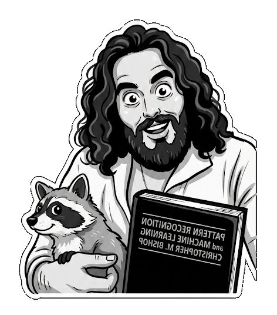
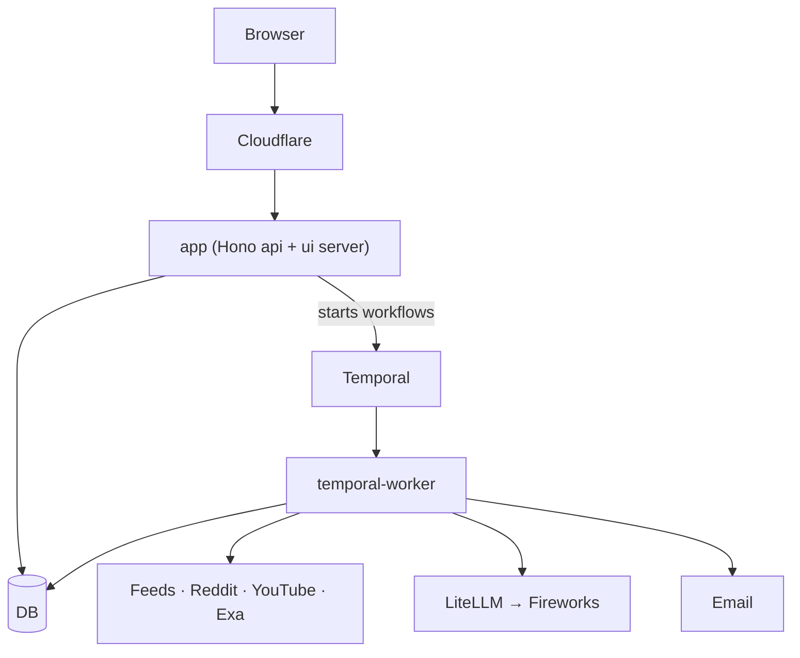
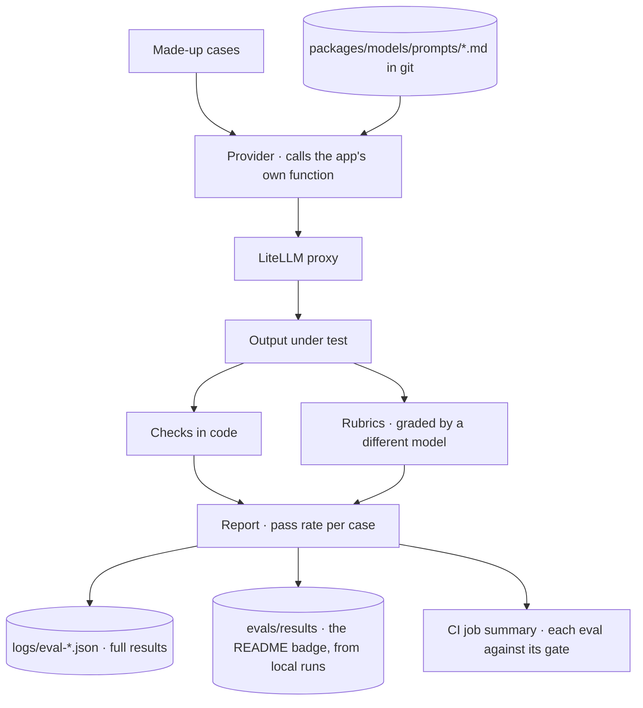

# CarlNotes

CarlNotes is a web app that reads each Topic's Sources on a schedule or on demand and keeps the Findings that match the
Topic's prompt. Its users get them in the Topic's Feed, a scan email, a podcast episode, and a chat. This README covers
the stack, how the apps and packages fit together, the evals, and the commands that run, check, and deploy the app.



**He already read it. All of it.**

Carl doesn't check the news. The news checks in with Carl. Carl never sleeps. He drinks coffee and reads everything. He
finished the internet. Now he checks nightly for new stuff. And when you drop by, he has notes and a podcast.

**Give Carl a topic. You know the one. He'll brew a hot cup of what you just missed.**

Carl stays up. You stay informed.

<br clear="left" />

[](https://codecov.io/gh/doubleoevan/carlnotes)
[](evals/README.md)

## Stack

Bun + TypeScript · React (TanStack Start + Vite + Tailwind + shadcn) · TanStack Query · Hono · Better Auth · Drizzle +
Neon Postgres (pgvector) · Temporal · LiteLLM → Fireworks + Gemini speech · Vercel AI SDK + Zod · Exa + Firecrawl +
TwitterAPI.io · Langfuse · OpenAI moderation · Sentry + PostHog

## Architecture

CarlNotes is one repository of Bun workspaces: four apps under `apps/` and nine private `@carlnotes/<name>` packages
under `packages/`, every one exporting source with no build step.

1. `apps/web` is a TanStack Start React app. Its public pages render on the server for a visitor, and every page renders
   in the browser for a signed-in user.
2. `apps/api` is a Hono server. It serves the routes below and renders every other page through the web app's server
   build:
   - every `/api` route
   - the Model Context Protocol (MCP) server at `/mcp` and its OAuth discovery documents
   - the document routes: the sitemap, the feeds, the llms files, the IndexNow key, and security.txt
   - the blog and release pages
   - the built docs
   - the built Nightshift component browser at `/nightshift`
3. `apps/worker` holds the Temporal worker, its workflows, the scheduled sweep, and the monthly budget reset.
4. `apps/docs` is the Starlight docs site, built to static files.

The packages come in two chains. Each arrow is the dependency order, which `AGENTS.md` spells out and
`scripts/check-package-boundaries.ts` enforces in preflight.

- The universal chain, `contracts` → `client` → `core`, holds the zod contracts, the typed api clients, and the
  DOM-free stores, hooks, and rules. `nightshift` sits beside it as the design system's tokens and type roles. No
  universal package names a Bun, Node, or DOM global.
- The server chain, `server` → `db` → `emails` → `models` → `pipeline`, holds the env settings and monitoring, the
  Drizzle schema, and the Redis and object stores. It also holds the email templates and send, every model call and
  prompt, and the scan pipeline with the chat replies and the podcast episode.



These processes run the app:

| Process | What it does |
|---|---|
| `app` | Serves the api and the web app, rendering public pages on the server. Chat replies and uploads run in-process. |
| `temporal-worker` | One process hosts six Temporal Workers, each polling one task queue. Attachments, topic scans, the closing writes that record a scan's outcome, scan emails, podcast episode recordings, and url Source screens each get their own Worker. The closing writes have their own queue, so a backlog of scans waiting for a slot never delays the write for a scan that paid for its review. If any Worker stops, the process exits and the platform restarts it. In production the Northflank service starts it with `bun run temporal`. |
| scheduler | `bun apps/worker/schedule.ts` sweeps for scheduled Topics and starts their scans. One query computes which Topics are scheduled from each Topic's frequency and its last completed Scan. So a sweep is safe to repeat, and no stored queue can drift. A job lease keeps two sweeps from overlapping. In production a Northflank cron job runs one sweep per interval (`bun run schedule`). |
| budget reset | `bun apps/worker/resetMonthlyBudgets.ts` replaces every LiteLLM key created before the month began, so each user's spend starts the month at zero. The reset replaces four keys at a time, under the same kind of job lease as the sweep. In production a Northflank cron job runs the reset once a day shortly after midnight UTC (`bun run reset:monthly-budgets`). After the first of the month, the reset finds only the keys that an earlier run failed to replace. |

Every process above runs on Northflank, which deploys a commit on `main` once CI passes it. `app` and `temporal-worker`
each run as replicas. The state that every `app` replica shares lives in Redis. Temporal gives each scan to one worker.
Beside them run Neon Postgres (pgvector), a single-node Redis addon reached as `REDIS_URL`, object storage, a
self-hosted Temporal server, Resend, and Stripe. Object storage goes through Bun's S3 client, and R2 serves it today,
picked by the `S3_*` env values.

Model calls go through a LiteLLM proxy in front of Fireworks. Every user gets a virtual key with a monthly budget. The
[litellm config](litellm-config.yaml) maps role names to models, so a model swap is a config edit.

### Spend control

Spend is bounded at three levels. A user's LiteLLM key stops at their monthly budget, and the monthly budget cutoffs
pause kinds of that user's spend as their month runs down. The daily spend cutoffs bound the whole free plan: they read
one number, the UTC day's spend billed to free users who are not admins.

- Past the podcast episodes cutoff, 65 dollars by default, a free user's repeat podcast episodes are skipped. A Topic's
  first podcast episode still records.
- Past the scheduled scans cutoff, 100 dollars by default, a free user's scheduled scans do not start. Their Topics stay
  scheduled, and nothing is failed or emailed. Free users' first scans and manual scans wait for the first scan dispatch
  limit, which starts the 5 oldest per sweep by default.
- Past the chat cutoff, 150 dollars by default, a free user's chat with Carl pauses, and a chat turn says Carl is
  taking a break until midnight UTC.
- When the UTC day turns, every cutoff clears and everything paused starts again.

A paid user is never paused or slowed. A new Topic's first scan is never skipped: at most it waits its turn. The admin
console's Limits section counts down to the cutoffs' reset at midnight UTC and meters the day's free-plan spend
against every cutoff, the waiting scans, and the past hour's signups. It overrides every setting without a
deploy. Turning off its permission for unverified email sign-ups to scan and chat makes their first and manual scans
wait whatever the day's spend, and chat and voice say that Carl will answer once the email is verified. The same
section pauses new podcast episodes, pauses new films, sets a film's generated image limit, and leaves the home its
pinned items alone. Each is off until an admin sets it. Each sweep also alerts once an hour's signups reach 50, and
that alert pauses nothing. The [deployment guide](apps/docs/deployment.md#spend-control-settings) lists the
settings, and its [Launch runbook](apps/docs/deployment.md#launch-runbook) says what to watch during a wave, how to
add capacity, and what each switch stops.

The domain vocabulary lives in `.agents/skills/domain-model/`. The code uses those nouns, so grepping a domain noun
finds its code. [apps/docs/ai-scaffolding.md](apps/docs/ai-scaffolding.md) explains how the repo constrains
AI-generated code. Feature work goes through [OpenSpec](https://github.com/Fission-AI/OpenSpec), one change at a time.
The specs and the changes in progress live in `openspec/`.

The [runtime architecture guide](apps/docs/runtime-architecture.md) follows a Scan through review, podcast recording and delivery. It also covers chat, live updates, content safety, edge caching, and deploy health checks.

## Evals

An eval measures what a model-facing prompt writes, an output that has no one exact value for a test to check. Every
eval but the review pipeline runs on [promptfoo](https://www.promptfoo.dev), an eval framework. Each promptfoo eval runs
made-up cases through the same function that the app calls, with the prompt templates in git. It grades every output in
code where it can, such as links, lengths, ids, and the tools a chat turn called. Where a grade takes judgment, a second
model grades the output against a written rubric. A model's output varies from run to run, so an eval reports how often
each case passes. The evals make real model calls, so they never run in `bun run check`. The Evals workflow runs the
promptfoo evals in CI, report-only.



| Eval | What it measures | Command |
|---|---|---|
| Grader calibration | Every eval's rubric graders: an output that keeps a rubric passes, and one that breaks it fails | `bun run eval:grader-calibration` |
| Review pipeline | Precision, recall, and cost of the relevance gate and the scoring prompt over hand-labeled fixtures | `bun run eval:review-pipeline` |
| Podcast episode script | The outline and segment prompts: chapters cite real Findings, every claim is supported, quotes are short and named, the title and description fit, three Findings or fewer make one segment and four or more make two to four, with a transition into each one after the first, and the goodbye is left to the show | `bun run eval:podcast-episode-script` |
| Scan report | Carl's note on every scan: links every kept finding and nothing else, says nothing the scan data lacks, names a failed source, stays short | `bun run eval:scan-report` |
| Updates opener | Carl's opener above an updates list: stays true for every list that day, names no Finding or count, and never says what the reader missed | `bun run eval:updates-opener` |
| Dashboard paragraph | Carl's paragraph above a Specials page's charts: uses only the numbers and countries it was given, asks nothing of the reader, names no item or person, and sounds like Carl | `bun run eval:dashboard-paragraph` |
| Topic post summary | The summary a published Topic Post shows in its info popup: keeps the post's key facts, says nothing the post lacks, is about the subject and never "the post", and summarizes an instruction inside the post instead of following it | `bun run eval:topic-post-summary` |
| Topic post discussion | The script of Carl and Vienna's recorded talk about a Topic Post: both hosts speak inside five minutes, cover the post's key facts, state nothing the post and its Comments lack, credit each Comment by username, follow the starter's note, and never follow an instruction inside a Comment or the note | `bun run eval:topic-post-discussion` |
| Topic post chat | A question asked from a Topic Post's page: a vague question is answered from the post, an answer that draws on a shared Comment credits its author by username, no reader is spoken for with no Comment shared, an instruction in a Comment is never followed, and a request to change the topic changes nothing | `bun run eval:topic-post-chat` |
| Topic matching | How a sent item ranks a user's editable Topics, with no model writing anything: the right Topics rank first, and an item that fits no Topic leaves every Topic unchecked | `bun run eval:topic-matching` |
| Topic chat | The topic chat: opens by answering the question, credits the findings only with what they say, marks what comes from outside them, answers a question about the app from the docs, links only real finding and docs urls, stays brief | `bun run eval:topic-chat` |
| Team chat | The chat on a team's page, across the team's topics: names the right topic for each finding, credits the findings only with what they say, links only real finding and docs urls | `bun run eval:team-chat` |
| Topic chat tools | The topic chat's edit tools, in the solo chat and the team room: a change of settings, sources, or prompt is proposed before it is saved, a yes saves it, a decline takes the preview back, a question or an instruction inside a finding calls nothing, and no reply claims an action that no tool made | `bun run eval:topic-chat-tools` |
| Podcast chat | A question asked out loud from the podcast player: a vague question is answered about the chapter that was playing, the question picks Carl or Vienna, an instruction in the chapter never picks the host, and the answer reads aloud with no markdown | `bun run eval:podcast-chat` |
| New-topic chat | The chat that makes a topic: writes what the user says to the draft, its visibility included, creates the topic only after a yes, never calls a change saved that no tool saved | `bun run eval:new-topic-chat` |
| Source suggestions | The suggested Sources, end to end through Exa and the readability checks: the share of new suggestions that resolve and read, enough readable sources, every one on topic and still publishing | `bun run eval:source-suggestions` |
| Search queries | The queries that a Scan writes for a topic: within the limit, distinct, plain text, on topic, and respecting what the topic skips | `bun run eval:search-queries` |
| Attachment summaries | The summary of an attached document and the description of an attached image: nothing the attachment does not show, the facts a user needs, and a long document summarized from the part before its cut | `bun run eval:attachment-summaries` |
| Personal sources context | Bounded summaries of synthetic received content, deletion, long imports, and adversarial text, using development model configuration | `bun run eval:personal-sources-context` |
| Personal sources scoring | Two senders, adversarial instructions, exact page evidence, and private annotation isolation with disposable development accounts | `bun run eval:personal-sources-scoring` |

The review pipeline's baseline comes from two public topics' fixtures on 2026-10-05. Dev Tools for Builders scored 68%
precision and 83% recall, and AI Coding Tools 93% and 100%, at $0.10 a fixture. The fixtures, their labels, and what the
numbers can and cannot say are in [evals/README.md](evals/README.md).

Every eval whose prompt reads outside material that a case can hold also has a case with an instruction planted in that
material, which the output must not follow. The source suggester reads live search results, which a case cannot hold.
Every promptfoo eval shares `evals/evalHarness.ts`. The harness runs the cases and grades the rubrics on a model other
than the one under test. It prints the report with the eval's pass rate and its 95% interval, and it saves the full
results. Each eval names its gate, the pass rate that it has to clear.

A local run saves its pass count, its commit, and its models to `evals/results/`. The evals badge at the top of this
README reads that folder, so commit `evals/results/` after the runs it should show. The grader calibration eval checks
the graders themselves, so run it first if a grader model changes. Run an eval before shipping a change to its prompt or
its model, with `--repeat 3` to see how often each case passes. Each eval costs cents to a dollar a run, and the review
pipeline's cost depends on its fixtures.

```bash
bun run eval:scan-report --repeat 3                 # run each case three times and print a pass rate per case
bun run eval:review-pipeline --with-examples        # score with the topic's rated and bookmarked pages as examples
```

This command exports a review pipeline fixture from the production database, which holds a public topic's ratings. It
reads the database only, and it writes the page text to a gitignored page cache:

```bash
doppler run --config prd -- bun evals/review-pipeline/reviewPipelineEval.ts --export <topicId>
```

The Evals workflow (`.github/workflows/evals.yml`) runs every promptfoo eval one at a time against a LiteLLM container.
It runs each case once on a push to main that changes a prompt, the code that builds one, the model config, or an eval.
It runs each case three times weekly or by hand. It only reports. An eval below its gate is a warning, the build still
passes, and a run in CI saves no result. The job summary lists each eval's pass rate, interval, and gate, and the full
results are an artifact of the run. The review pipeline eval is not a promptfoo eval and runs only locally, where its
gitignored page cache lives.

How each eval works, how to read its report, and how to write a new one live in [evals/README.md](evals/README.md).

## Development

```bash
bun install
bun run dev          # api, ui, temporal, worker, and the email preview together (concurrently, colored per process); run carl-up first for the Docker infra
                     # `mkdir -p logs && bun run dev 2>&1 | tee logs/dev.log` keeps a copy to tail from another shell; logs/ is gitignored
                     # every line is prefixed with its process, so `grep '^\[api\]' logs/dev.log` reads one of them
bun run carl-up      # bring up the Docker infra (litellm proxy, temporal dev server, Redis) and create a limited dev key; carl-down stops it
                     # scans run as Temporal workflows, so dev:temporal must be up for any scan to happen, not only for attachments
bun run dev:ui       # Vite dev server for the web app in apps/web; wraps itself in doppler run
bun run dev:api      # Hono API; wraps itself in doppler run for DATABASE_URL; the Vite dev server proxies /api, /mcp, and the api's own pages and documents here
bun run dev:worker   # scheduled-scan sweep loop, one sweep a minute (the script sets SCHEDULE_INTERVAL_MS=60000); `bun run schedule` runs one sweep, as a cron would
bun run reset:monthly-budgets # replace every LiteLLM key created before the month began, as the daily cron does. a later run in the same month replaces only the keys that an earlier run failed to replace
bun run temporal     # Temporal worker for topic scans and attachment processing, as the Northflank service starts it; needs a Temporal server (docker-compose `temporal`, or `temporal server start-dev`)
bun run dev:temporal # the same worker, kept as the dev name beside dev:api and dev:ui
bun run dev:temporal:watch # the same worker, restarted on save; what `bun run dev` uses. a restart mid-review leaves that scan waiting out its 30-minute activity timeout before it fails
bun run dev:email    # React Email preview at localhost:3011; Bun renders templates and approval states to temporary HTML; no Doppler needed
bun run dev:docs     # Starlight dev server on localhost:4321/docs, reachable on the LAN, with hot reload; also shows draft pages that the production build leaves out
                     # run by an agent, it starts in the background: `cd apps/docs && astro dev stop` ends it, `astro dev logs` tails it
bun run test:coverage # the test suite with bun's built-in line and function coverage table
bun run smoke:coverage # run every smoke test script, one process each, writing coverage/smoke/<name>/lcov.info; the Smoke workflow runs this on each push to main and uploads them under the smoke flag. the list is read from the smoke script, and the seo and mcp smoke tests need the web app built first (`bun run build:ui`)
                     # with SMOKE_SKIP_DEVELOPER_ONLY=1 it skips the ones that need litellm or temporal. the Smoke workflow starts both as containers instead, and runs a temporal worker beside them, and builds the web app first, so it runs every one
bun run docs:embed   # chunk the docs markdown by section and embed the changed sections into docs_chunks, which chat quotes; run it after editing docs
bun run docs:embed:prd # the same sync against the production database, owner-run. the release-main deploy job also runs it on every release
bun run topic-images:backfill -- --mode missing # under doppler, draw an image for every topic that has none; --mode redo draws every topic again, and --mode resize rederives the sizes from each stored original
bun run podcast-episode-images:backfill # under doppler, draw an image for every published podcast episode that has none, on the platform's key
bun run films:backfill # under doppler, start or join the film backfill that the worker also starts on boot: each topic's latest published podcast episode with no film gets one, and every ready film below the current render version is rendered again while it keeps playing, on the platform's bill, TOPIC_PODCAST_EPISODE_VIDEO_BACKFILL_CONCURRENCY at a time (default 1, and 0 turns the backfill off); the worker logs the counts so far and the films left after each batch, and the script prints the rendered, skipped, and failed counts, the generated images drawn, the render time, and the stored bytes. TOPIC_PODCAST_EPISODE_VIDEO_CONCURRENCY (default 1) sets the episode-videos queue's renders per replica, and 0 turns films off. a chapter draws generated images until it shows one distinct image for every 30 seconds, up to TOPIC_PODCAST_EPISODE_VIDEO_GENERATED_CHAPTER_IMAGE_LIMIT (default 40) a film, and 0 turns them off
bun run edge:purge   # clear the pages and the signed-out feed that Cloudflare shares; the deploy job that runs right after the app deploys
bun run sync:releases # re-read every published GitHub release into the releases table the /releases endpoint serves; it seeds history and repairs a missed webhook delivery, and is safe to re-run
bun run sync:releases:prd # the same sync against the production database; run it once after the first deploy, since the table starts empty. the webhook writes it going forward
bun run releases:preview <tag> "<title>" # store release-notes/<tag>.local.md in the dev releases table with the repo's screenshots inlined, so /releases and /releases/<tag> read as they will before the release exists on GitHub
bun run build:ui     # production build of apps/web to apps/web/dist, the MCP views' two scripts and stylesheet in apps/web/dist/mcp-views included (no doppler, so it runs in CI and deploys)
bun run build:docs   # build static docs to apps/docs/dist, which the api serves at /docs
                     # /docs on the api (3000) and through the Vite proxy (5173) is this build, which only changes when you rerun this script and doesn't hot reload
bun run dev:storybook # the Nightshift component browser, Storybook with hot reload on localhost:6006 and this Mac's LAN address, and its MCP server at localhost:6006/mcp that .mcp.json and opencode.json register; no doppler needed
bun run build:storybook # build the component browser to apps/web/dist/nightshift, which the api serves at /nightshift; run it after build:ui, which can clear apps/web/dist
bun run nightshift:write # write packages/nightshift/tokens.css, uniwind.css, and the Figma token files from the Nightshift TypeScript source; run it after changing a token. tokens.test.ts fails until you do
bun run dev:mobile   # Expo dev server for apps/mobile under doppler, with the expo-mcp server on and Storybook's telemetry off; a development build connects from a simulator, an emulator, or a phone on the LAN, and carlnotes:///storybook opens the component browser in it
bun run dev:tunnel   # the Cloudflare tunnel for Apple's callback at apple-dev.carlnotes.com and Resend's inbound webhook at resend-dev.carlnotes.com; run it beside the local api
bun run mobile:build -- --profile development-simulator # EAS (Expo Application Services) cloud build of the mobile app; profiles: development, development-simulator, preview, production. rebuild the development client after a change that adds a native module, as the sign-in change did
bun run mobile:update -- --channel production --environment production # publish an EAS Update to a channel's builds, on the fingerprint runtime policy; eas update needs both flags
bun run mobile:env:sync # move the mobile values (the Sentry DSN, the PostHog key, the Play Integrity cloud project number, the Google Maps keys, the Sentry auth token) from Doppler dev and prd into the EAS environments
bun run mobile:submit -- --platform ios # submit the latest production build to App Store Connect or, with android, the Play internal track, under Doppler prd: the store keys (ASC_APP_ID, APPLE_TEAM_ID, ASC_KEY_ID, ASC_ISSUER_ID, ASC_API_KEY_BASE64, PLAY_SERVICE_ACCOUNT_BASE64) are written for the length of the submit and removed after; --dry-run does everything but the submit
bun run contract:freeze # write contracts/<app-version>.json, every api route the mobile app reaches as JSON Schema; -- --check fails when the file differs from a fresh freeze, and the submit runs it first
bun run mcp-views:freeze # under doppler, store the MCP view bundle a host locks to: upload it to object storage, add it to packages/contracts/mcpViewVersions.json, and raise the current version; -- --bundle names a folder built from another commit, and --mcp-views the MCP views it holds
bun run reviewer:seed -- --environment prd # create or refresh the store reviewer's account in the named environment, under doppler run --config of the same name, with a Topic, its Findings and recap, a Note, a Team room, and a followed public Topic with a Podcast Episode; REVIEWER_EMAIL and REVIEWER_PASSWORD come from Doppler and are never printed
```

The homepage needs `dev:ui` and `dev:api` running, or `bun run dev` for the whole stack, plus a seeded dev database
(below). Every dev, db, and smoke script except `dev:email`, `dev:docs`, `dev:storybook`, and `db:generate` wraps itself
in `doppler run`, so those scripts need a Doppler-configured machine.

For database migration and seeding, Apple sign-in, Resend receiving, push notifications, podcast and billing settings, use the [development services guide](apps/docs/development-services.md).

Run `bun run db:migrate` to apply development migrations and `bun run db:seed` to populate the database. After changing proxy settings, run `bun run litellm:restart`.

Checks: `bun run check` runs the full gate, the same `scripts/preflight.sh` that the pre-push hook runs:

```bash
bun run check       # biome + adopted component conventions + package boundaries + dependency pins + knip + component parity + client parity + purchase paths + contract freeze + tsc + workflow bundles + bun test
```

Or run them individually:

```bash
bunx biome check .
bun run check:components               # enforce only the six adopted component files
bun run report:components              # report the wider feature-component inventory without failing on findings
bun run report:components -- --json    # deterministic classifications, locations, and counts
bun scripts/check-package-boundaries.ts # every import stays inside the dependencies its workspace declares
bun scripts/check-dependency-pins.ts    # .bun-version names the Dockerfile's Bun, the lockfile installs every patched package at its patched version, and docker-compose.yml runs the LiteLLM image infra/litellm/Dockerfile starts from
bunx knip                               # no file, export, type, or declared dependency is left unused
bun scripts/check-component-parity.ts   # every Nightshift component contract is implemented in each app it names, and a component both apps define shares its core component or is listed in apps/mobile/parity.md
bun scripts/check-client-parity.ts      # every api capability the web reaches is reachable from the app, or listed in apps/mobile/parity.md
bun scripts/check-purchase-paths.ts     # checkout and the billing portal stay out of the mobile app's reach
bun scripts/check-contract-freeze.ts    # no api change an unretired snapshot in contracts/ could not read or send
bunx tsc -b             # add --force after a dependency change. bun run check does that on its own
bun test
bun run check:workflows # every Temporal workflow file still bundles
bun run check:built-dependencies # after build:ui, apps/web declares every package its server build leaves external
bun run check:advisories # no high or critical advisory on the lockfile outside dependency-advisories.json. it asks the registry, so CI runs it in its own job and bun run check does not
```

Component conventions cover web components/pages, mobile components, and core components. Routes, entrypoints,
stories, tests/fixtures, generated files, Nightshift contracted implementations, and exact designated compound
primitives are excluded. Other TSX roots remain outside this rollout. The policy and six adopted paths live in
`scripts/componentConventionFiles.ts`; the convention is documented in `.agents/skills/jsx-conventions/SKILL.md`.
Both commands accept explicit repository-relative file paths; these replace their default selection. Report mode
returns 0 even for violations or identities requiring review. Strict mode returns 1 for either, while both return 2
for invalid input, parse errors, or incomplete tooling results. Neither rewrites source. JSON counts checked,
excluded, and review files separately; violating files can overlap checked/review, and diagnostic totals count every
finding. Unsupported wrappers and external component re-exports require review, since this is syntax analysis.

The Docker build runs `check:built-dependencies` right after `build:ui`. The production install links only the packages
`apps/web` declares, so an undeclared one fails the image build instead of every page render.

Knip reads the import graph from each workspace's entry points, which its plugins find in the package.json scripts and
the Vite, Expo, Storybook, Astro, and Drizzle configs. A file that only a `doppler run` script, a shell script, a
`new URL(...)`, or a string loads is declared in `knip.jsonc`, with a comment that names its loader. Every exception
there names one file, export, or dependency, and one that matches nothing fails the run, so a deleted file's entry
goes with it.

Live smoke tests (owner-run) exercise real flows against live services (LiteLLM proxy, Firecrawl, object storage). They
make paid calls, so they are **not** part of `bun run check`. They need the LiteLLM proxy up
(`docker compose up -d litellm`) and the latest migration applied. The attachment smoke test also needs a Temporal
server (`docker compose up -d temporal`) and the running worker (`bun run dev:temporal`):

```bash
bun run smoke              # run every smoke test but smoke:signup and smoke:mcp-views
bun run smoke:scan         # the topic-scan smoke test (ingestion + review, end-to-end)
bun run smoke:store        # the resource-content object-storage round-trip (put → read → delete)
bun run smoke:attach       # the URL-attachment smoke test (Firecrawl → store → Temporal workflow → ready)
bun run smoke:search       # the web search smoke test (context → LLM queries → Exa → Resources)
bun run smoke:reddit       # the reddit access smoke test: a subreddit and a search Source through each mode, reporting which one answered
bun run smoke:x            # the X smoke test: one account's tweets and what they cost, plus the lookup that vets a suggested account
bun run smoke:speech       # the podcast speech smoke test: a two-speaker clip on each Gemini tier
bun run smoke:podcast-episode  # the podcast episode smoke test: one episode from its plan to its removal. needs ffmpeg
bun run smoke:review       # the review smoke test: the paid section buys its best survivors, bounded by its limit
bun run smoke:subscribers  # the subscriber-count smoke test: both subscription paths against real rows, rolled back after
bun run smoke:profile      # the profile smoke test: the header's distinct people against the footer's summed rows
bun run smoke:social       # the reactions and comments smoke test: one row per user, the edit time, the reads, and the blocks
bun run smoke:news         # the news smoke test: the windows, the three groups, ties, grouped reactions, the blocks, the person's own Topic Posts, a profile's public rows, and the pages
bun run smoke:seo          # the seo smoke test: builds the ui, then checks every public page arrives whole to a browser without JavaScript on its first render, that only public topics are listed, that the edge can share a signed-out page and the feed but never a signed-in one, and that a card is immutable only at its version
bun run smoke:image <image> # the image smoke test: boots a built image with dummy settings against an empty Postgres and checks the home page, /plans, and both health routes respond 200. needs Docker
bun run smoke:signup       # the signup smoke test: builds the ui under doppler, then opens the signup page in this machine's Chrome and checks that the Turnstile challenge issues a token the signup gate accepts, with no content security policy violation
bun run smoke:chat         # the topic chat retrieval smoke test (question → ranked findings → assembled context)
bun run smoke:eval         # the review pipeline eval's smoke test: one tiny labeled fixture through the real gate and scoring
bun run smoke:teams        # the team-lifecycle smoke test: creation, join fan-out, limits, last-leader, deletion, detach succession, the team page gate, its avatar versions, and who sent an invite or invited a member
bun run smoke:room         # the team chat-room smoke test: the access matrix, isolation, budget rejection, mention rows, and the room lock
bun run smoke:rooms        # the chat-rooms smoke test: which rooms a user can open, one per holding team, and the unseen count
bun run smoke:chat-turns   # the chat turn shapes smoke test: each kind's row and each chat proposal shape is kept, each mismatched row is rejected, rolled back
bun run smoke:push-devices # the push devices smoke test: ending a session or closing the account deletes its phones, one send per event, recipient, and phone, rolled back
bun run smoke:mcp          # builds the ui, then checks both MCP routes: Origin, twenty-six-tool contracts, private access, result bounds, OAuth and revocation, MCP views, writes, confirmations, and rate limiting
bun run smoke:mcp-views    # builds the MCP view bundle in two Vite builds, one for the dashboard MCP view's own script, then runs each MCP view in this machine's Chrome under the test host, offline, as part of `bun run check`
bun run seed:personal-sources owner@example.com # retain synthetic review Topics for an existing development owner
bun run smoke:personal-sources        # development persistence plus real model/Temporal receive → summarize → Scan → delete; --keep retains synthetic fixtures, and live runs just the integrated section
bun run smoke:personal-sources imports context links email # rerun selected Personal sources smoke sections after a focused change
bun run smoke:tools        # the topic tools smoke test: the gate inside each tool, the prompt version writes, adding and removing sources up to the limit, and that no tool starts a scan
bun run smoke:podcast-episodes # the podcast episode routes smoke test: access, audio, feeds, covers, and removal
bun run smoke:search-plans # the search plans smoke test: no HNSW scan in the topic ranking, trigram indexes in the name searches
bun run smoke:invites      # the invite smoke test: link authority and races, resolution, who-may-invite, connections, accept-equals-redeem, and each sent invite's avatar version
```

Before handing off an MCP change, pass `bun run check` and `bun run smoke:mcp`. The offline gate covers Origin
rejection and the complete annotation matrix. The live smoke retains consent, writes, MCP views, and rate limiting,
and checks private access, complete pagination, separate text and structured result sizes, and refresh revocation.
It needs development Postgres, Redis, LiteLLM, Temporal, and its worker (`bun run dev:temporal`). Fixtures use isolated
IDs and are removed in `finally`.
The existing Smoke workflow selects this test through the smoke suite on pushes to main. That workflow is separate
from the deployment prerequisite jobs; a passing live run is required release evidence for an MCP change.

The root `server.json` describes the remote server for the official MCP Registry. With the
[official publisher](https://github.com/modelcontextprotocol/registry/releases) installed, validate it from the repo root:

```sh
mcp-publisher --version
mcp-publisher validate server.json
```

Validation does not publish. Domain proof for `com.carlnotes`, registry publication, directory submissions, reviewer
credentials, and post-deploy URL checks remain manual. The public guide is `/docs/account/add-to-ai/`; the privacy
policy is `/privacy`. Confirm hosted analytics retention matches that policy before claiming directory readiness.

Run the reddit smoke test from the deployed environment as well as from a laptop. Reddit's keyless endpoints serve a
home internet connection but can return 403 to a hosting provider's IP range. So the same test can pass on your machine
and fail in production.

The review smoke test reads `REVIEW_CONCURRENCY` and `MAX_SCORED_RESOURCES_PER_SCAN`, so it doubles as an A/B test of
the concurrency limit. Each run first clears every cached field on its feed's Resources, so two runs differ only by
their settings:

```bash
REVIEW_CONCURRENCY=1 MAX_SCORED_RESOURCES_PER_SCAN=8 bun run smoke:review
```

Load testing shows how many requests one api process can serve at once. [oha](https://github.com/hatoo/oha)
(`brew install oha`) keeps a set number of requests going. It reports the requests per second and how long the requests
took, from the fastest to the slowest. Point it at the local dev api, never at carlnotes.com. A local run is unlimited,
because the api's rate limits skip a request from this machine's own address with no session, as a page render's calls
are. A run against production meets the general limit of 1,800 requests a minute and the topic feed's 120 a minute, and
the requests it gets through cost real database time.

```bash
oha -c 50 -z 30s http://localhost:3000/api/topic-feed   # 50 requests at a time for 30 seconds, as a signed-out visitor
curl -s http://localhost:3000/api/health/deep            # run it during the test to see the pool's open, idle, and waiting connections
grep '"gauges"' logs/dev.log                             # the api's once-a-minute line: the pool and the event loop delay
```

Compare each run with one from before your change, not with production. A laptop reaches the dev database over the
internet, so every query takes longer than it does next to the database.

The evals and their `eval:*` scripts are described under [Evals](#evals).

The visual UI checks run in the UI tests workflow after a push to main, nightly, and by hand. They report and never
gate a push or a deploy. CI's gate cancels its run for an earlier push when a newer one arrives, and so does the UI
tests workflow for push runs. The next UI tests run still selects the cancelled run's commits, because it diffs against
the last green run's commit. `ui-tests/AGENTS.md` explains how to read a failure and approve a baseline. The approved
images are stored in Git LFS. Approving needs git-lfs, which `bun run carl-up` installs if it is missing.

```bash
bun run visual:select -- --base origin/main # choose the stories that a change reaches, written to ui-tests/output/selection.json. --all selects every story
bun run visual:web      # build the component browser and capture the selected stories in the pinned capture container, then compare each with its approved baseline
                        # --story <id> captures named stories, --skip-build reuses the last build, and --on-host uses the host's Chrome, which no baseline is approved from
bun run visual:report   # write ui-tests/output/report.html and the run summary from the latest image captures
bun run visual:open -- <run id>    # download a UI tests run's report and open it
bun run visual:approve -- --run <run id> # approve a run's changed and new image captures as baselines in the working tree; never commits
```

For the prompt registry, container image, release jobs and rollback, use the [deployment guide](apps/docs/deployment.md).

The prompt registry commands are `bun run prompts:sync` for development and `bun run prompts:sync:prd` for production.

### Deploy alerts

Set up [release and uptime monitoring](apps/docs/deployment.md#deploy-alerts) for the hosted service.

## Security

[SECURITY.md](SECURITY.md) says how to report a vulnerability. It also lists the dependency checks that run on their
own: Dependabot, the advisory check in CI, CodeQL, the pinned actions and image digests, and the three-day release
age. The advisory check, `bun run check:advisories`, fails CI's `advisories` job on a high or critical advisory that
the reviewed allowlist in `dependency-advisories.json` does not name. It runs apart from the gate, and no release
waits on it. Dependabot's security updates do not see transitive packages, so this check is the one that reports an
advisory on one. Dependency changes run through the pinned Bun, `bunx bun@1.4.4 add ...`, so the lockfile keeps the
format CI's Bun reads. CI reads that version from `.bun-version` through the shared `.github/actions/setup-bun` step.
The Dockerfile pins the same version in its image tag, and `bun run check` fails if the two differ.

## Attribution

The persona for CarlNotes was inspired by [Jake Van Clief](https://www.linkedin.com/in/jake-van-clief-74b66915a/). The
real Jake runs [Eduba](https://eduba.io), an AI training and consulting company, makes videos on
[YouTube](https://www.youtube.com/@JEVanClief), and teaches AI systems over at [Clief
Notes](https://www.skool.com/cliefnotes). Go learn from him. Carl would.

## License

AGPL-3.0-only
