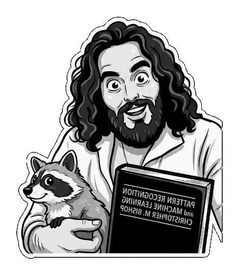
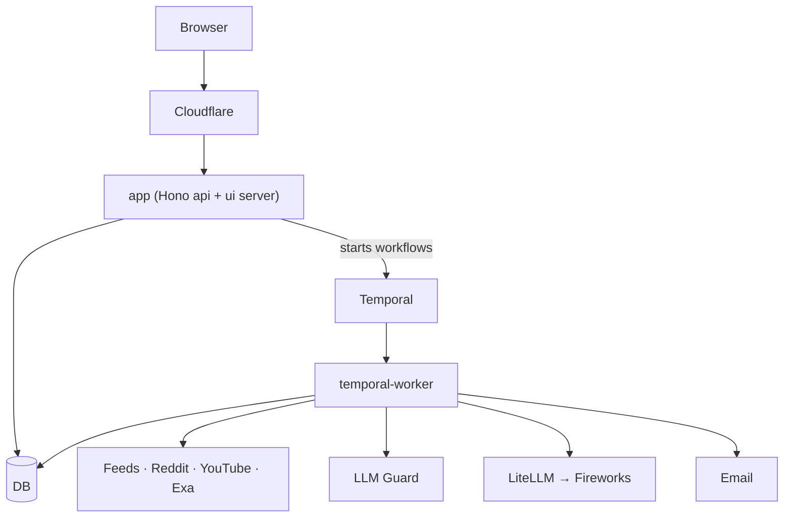
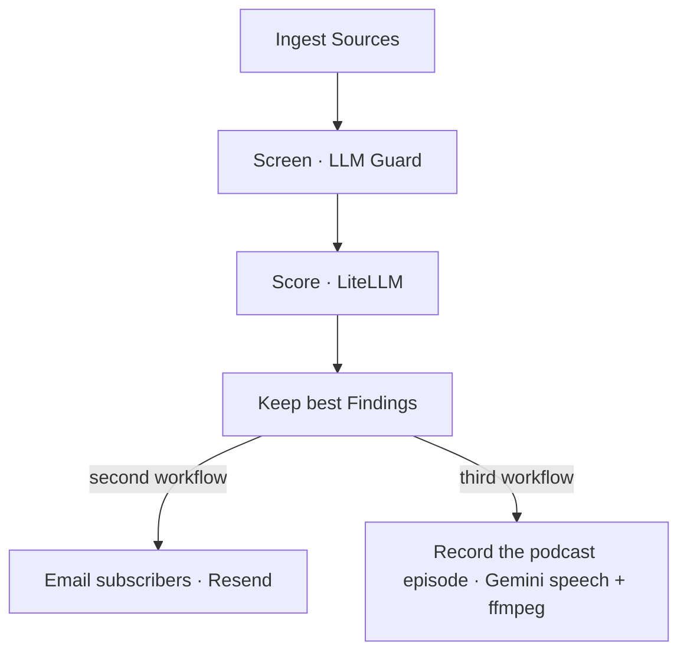
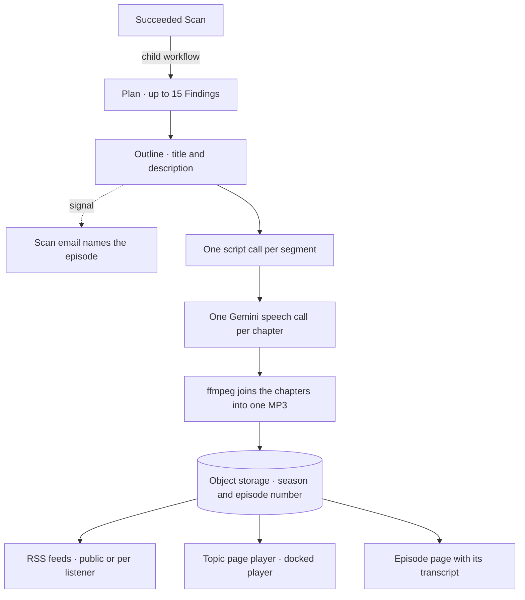
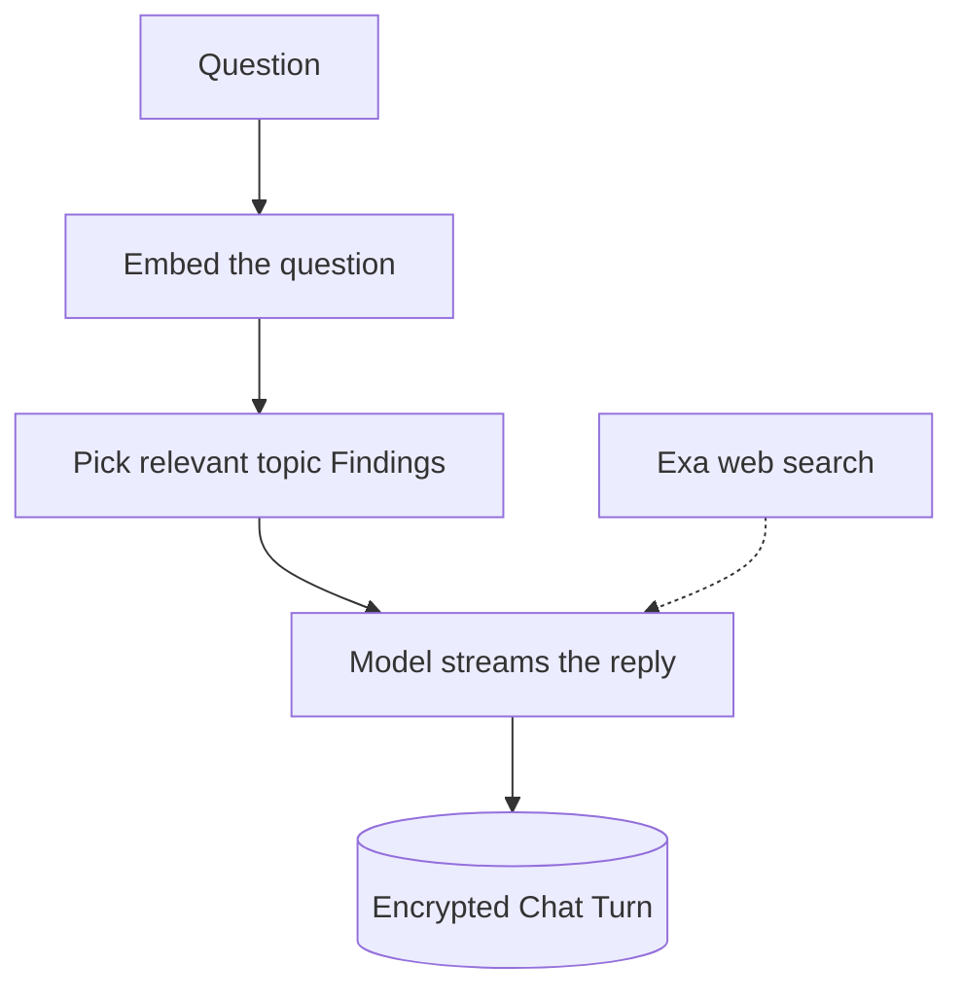
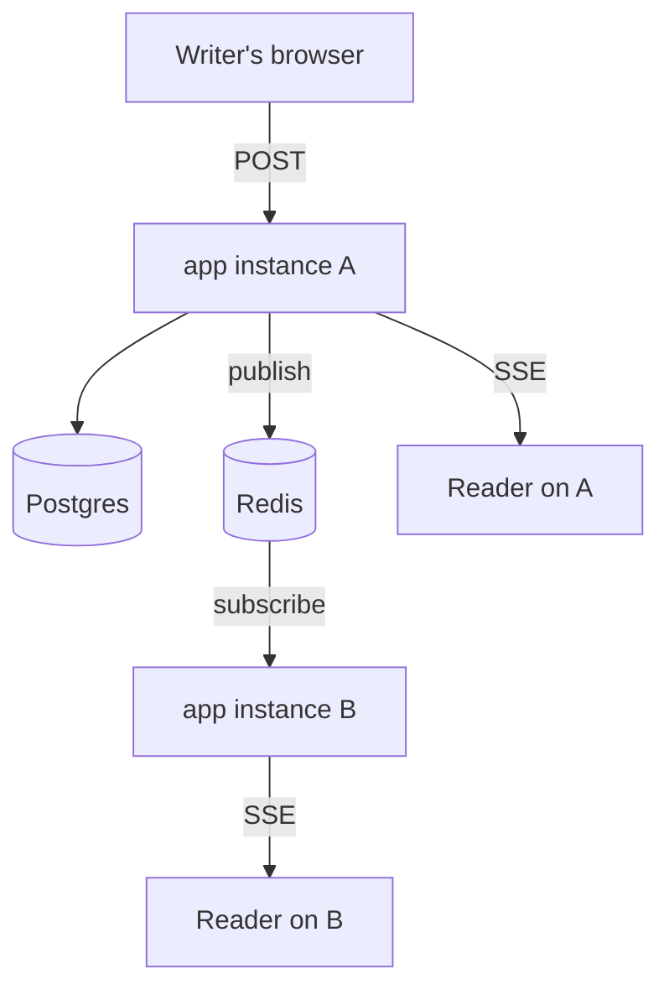
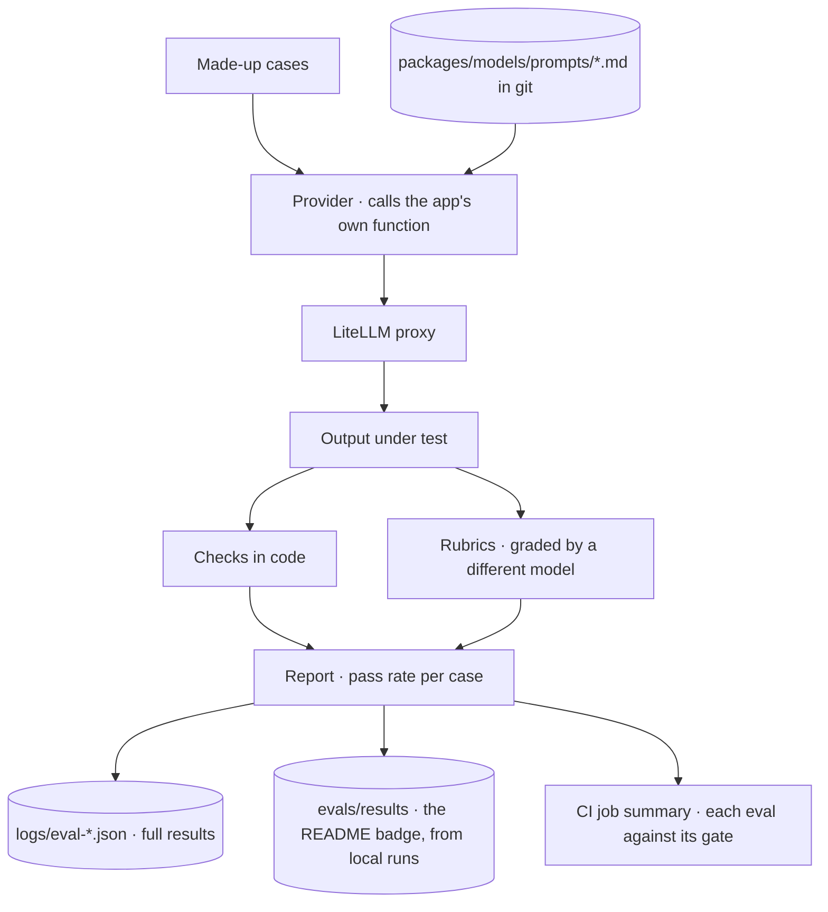

# CarlNotes

CarlNotes is a web app that reads each Topic's Sources on a schedule or on demand and keeps the Findings that match the
Topic's prompt. Its users get them in the Topic's Feed, a scan email, a podcast episode, and a chat. This README covers
the stack, how the apps and packages fit together, the evals, and the commands that run, check, and deploy the app.



**He already read it. All of it.**

Carl doesn't check the news. The news checks in with Carl. Carl never sleeps. He drinks coffee and reads everything. He
finished the internet. Now he checks nightly for new stuff. And when you drop by, he has notes and a podcast.

**Give Carl a topic. You know the one. He'll brew a hot cup of what you just missed.**

Carl stays up. You stay informed.

<br clear="left" />

[](https://codecov.io/gh/doubleoevan/carlnotes)
[](evals/README.md)

## Stack

Bun + TypeScript · React (TanStack Start + Vite + Tailwind + shadcn) · TanStack Query · Hono · Better Auth · Drizzle +
Neon Postgres (pgvector) · Temporal · LiteLLM → Fireworks + Gemini speech · Vercel AI SDK + Zod · Exa + Firecrawl +
TwitterAPI.io · Langfuse · LLM Guard · Sentry + PostHog

## Architecture

CarlNotes is one repository of Bun workspaces: four apps under `apps/` and nine private `@carlnotes/<name>` packages
under `packages/`, every one exporting source with no build step.

1. `apps/web` is a TanStack Start React app. Its public pages render on the server for a visitor, and every page renders
   in the browser for a signed-in user.
2. `apps/api` is a Hono server. It serves the routes below and renders every other page through the web app's server
   build:
   - every `/api` route
   - the Model Context Protocol (MCP) server at `/mcp` and its OAuth discovery documents
   - the document routes: the sitemap, the feeds, the llms files, the IndexNow key, and security.txt
   - the blog and release pages
   - the built docs
   - the built Nightshift component browser at `/nightshift`
3. `apps/worker` holds the Temporal worker, its workflows, the scheduled sweep, and the monthly budget reset.
4. `apps/docs` is the Starlight docs site, built to static files.

The packages come in two chains. Each arrow is the dependency order, which `AGENTS.md` spells out and
`scripts/check-package-boundaries.ts` enforces in preflight.

- The universal chain, `contracts` → `client` → `core`, holds the zod contracts, the typed api clients, and the
  DOM-free stores, hooks, and rules. `nightshift` sits beside it as the design system's tokens and type roles. No
  universal package names a Bun, Node, or DOM global.
- The server chain, `server` → `db` → `emails` → `models` → `pipeline`, holds the env settings and monitoring, the
  Drizzle schema, and the Redis and object stores. It also holds the email templates and send, every model call and
  prompt, and the scan pipeline with the chat replies and the podcast episode.



These processes run the app. Production runs every one but `llm-guard`:

| Process | What it does |
|---|---|
| `app` | Serves the api and the web app, rendering public pages on the server. Chat replies and uploads run in-process. |
| `temporal-worker` | One process hosts six Temporal Workers, each polling one task queue. Attachments, topic scans, the closing writes that record a scan's outcome, scan emails, podcast episode recordings, and source screens each get their own Worker. The closing writes have their own queue, so a backlog of scans waiting for a slot never delays the write for a scan that paid for its review. If any Worker stops, the process exits and the platform restarts it. In production the Northflank service starts it with `bun run temporal`. |
| scheduler | `bun apps/worker/schedule.ts` sweeps for scheduled Topics and starts their scans. One query computes which Topics are scheduled from each Topic's frequency and its last completed Scan. So a sweep is safe to repeat, and no stored queue can drift. A database claim keeps two sweeps from overlapping. In production a Northflank cron job runs one sweep per interval (`bun run schedule`). |
| budget reset | `bun apps/worker/resetMonthlyBudgets.ts` replaces every LiteLLM key created before the month began, so each user's spend starts the month at zero. The reset replaces four keys at a time, under the same kind of database claim as the sweep. In production a Northflank cron job runs the reset once a day shortly after midnight UTC (`bun run reset:monthly-budgets`). After the first of the month, the reset finds only the keys that an earlier run failed to replace. |
| `llm-guard` | The content scanner is its own service (see below). Production runs without it. |

Every process above but `llm-guard` runs on Northflank, which deploys on a git trigger. `app` and `temporal-worker`
each run as replicas. The state that every `app` replica shares lives in Redis. Temporal gives each scan to one worker.
Beside them run Neon Postgres (pgvector), a single-node Redis addon reached as `REDIS_URL`, object storage, a
self-hosted Temporal server, Resend, and Stripe. Object storage goes through Bun's S3 client, and R2 serves it today,
picked by the `S3_*` env values.

Model calls go through a LiteLLM proxy in front of Fireworks. Every user gets a virtual key with a monthly budget. The
[litellm config](litellm-config.yaml) maps role names to models, so a model swap is a config edit.

The domain vocabulary lives in `.agents/skills/domain-model/`. The code uses those nouns, so grepping a domain noun
finds its code. [apps/docs/ai-scaffolding.md](apps/docs/ai-scaffolding.md) explains how the repo constrains
AI-generated code. Feature work goes through [OpenSpec](https://github.com/Fission-AI/OpenSpec), one change at a time.
The specs and the changes in progress live in `openspec/`.

### Scan

A topic Scan is one Temporal workflow, its email is a second one, and its podcast episode is a third:



Each step costs more but handles fewer Resources. Embeddings (`embed-model`) filter and rank what the Sources found. A
cheap model (`cheap-model`) scores what passes. A more expensive model (`score-model`) re-scores the best Findings and
writes each Finding's relevance explanation. The cheap model then writes the scan report.

Temporal persists every step and retries failed activities, so the app needs no outbox table of pending sends. Once a
Scan is complete, its workflow starts the email workflow on the `scan-emails` queue. That workflow runs one activity per
Resend call. On a rate limit the activity waits for Resend's `retry-after`, and on a 5xx it backs off. A send that fails
for good is reported to Sentry without failing the Scan. Each accepted batch records its sends with the Scan, so a retry
never mails anyone twice.

Emails outside workflows (verification, password reset, invites, flag notices) go straight to Resend. The app reports a
failed one to Sentry and does not replay it. Every call to Resend, from the app or the worker, first takes a rate limit
slot kept in Redis, which one call holds for 200 milliseconds. So calls leave evenly spaced at five a second, half of
Resend's limit of ten.

A succeeded Scan also starts the podcast episode workflow, described under Podcast below.

### Podcast

Every Topic has a podcast with two AI hosts, Carl and Vienna. A succeeded Scan starts its episode as a child workflow on
the `episode-recordings` queue, and an episode never holds up the Topic's next Scan.



The plan picks up to fifteen Findings by score. It picks from the Scan's new Findings and from the ones a user liked or
bookmarked or whose page is one of the Topic's url Sources. A like, a bookmark, and a url Source's page each add a score
bonus of 0.2. A new Finding wins a tie, and the Scan's new ones are narrated first. Any slots left go to the Topic's
best that no episode has covered, then to ones that earlier episodes covered. A Finding rated thumbs down is never
narrated.

The outline call saves the episode's title and description and signals the Scan's email workflow. The email workflow
waits for that signal, so the email can name the episode. One script call per segment writes the two hosts' turns
against the outline, in up to three drafts. A draft that fails a check is retried with the reason, and a third draft is
repaired instead of failing the episode. The sign-off ends on two fixed lines and then a goodbye that the writer words
differently every time. The prompts are in `packages/models/prompts/`.

Each chapter is recorded as one two-speaker Gemini speech call through LiteLLM's pass-through. A manual Scan's
chapters are recorded on the standard tier, and a scheduled Scan's on Gemini's Flex tier, where a chapter can wait up to
six hours for capacity. A chapter whose speech fails for good is left out, and the episode publishes the rest. ffmpeg
joins the chapters into one MP3 in object storage, and the publish gives the episode its season, the UTC year, and its
number within that season.

An episode reaches listeners three ways:

- A public Topic has a public RSS feed at `/topics/:id/podcast.xml`. A private or invite Topic gives each listener
  their own feed at `/podcast-feeds/:token.xml`. Redis caches each feed while it lists up to 100 episodes.
- The topic page has the player, and a docked player follows the listener from page to page. When an episode ends, the
  next unplayed episode from the listener's other Topics starts.
- Each published episode has its own page with its transcript, rendered on the server for a public Topic.

Every episode page has its preview card, so a shared link previews whatever the Topic's visibility. A private or invite
Topic's episode page is marked noindex and shows the Topic's gate to anyone who cannot see the Topic. Covers are drawn
over `apps/docs/design/podcast/cover-base.png`.

`PODCAST_SPEECH_MODEL` set empty turns episodes off, and `PODCAST_RECORDING_CONCURRENCY` (16 by default) limits the
episode activities on each worker replica. A free Topic gets a 10-minute episode after every scan and keeps only the
latest short one, while a paid plan gets 30 minutes and keeps every full episode. A scan that finishes while a Topic's
short episode is still recording makes no episode, and its findings go into the next one. Each plan's monthly budget
cutoffs in `packages/contracts/plans.ts` turn a paid plan's episodes short, then pause every plan's episodes, so scans
keep running.

### Chat

Every Topic has a chat. Chat runs in the `app` process, not as a workflow. A reply streams back while the user waits,
and the user asks again if a reply is lost.

Chat is retrieval-augmented generation (RAG) over the Topic's own Feed: the app retrieves the relevant Findings, and the
model writes its reply from them. If the Feed cannot answer, the model can call a live Exa web search, billed per call.
For a user who can edit the Topic, the model can also preview a change to the Topic's settings, Sources, or prompt. The
server applies that change through the Topic Tools only if the user's next message agrees.



Chat is signed-in only. Every chat turn writes a row, because every chat turn is metered. The model spend is charged to
the asker's own LiteLLM key, sharing the same budget a topic scan charges. Before a turn, a transcription, or a spoken
part runs, its largest cost is reserved in Redis. The budget is a soft limit: a call starts while the recorded spend and
the open reservations are below it, so a user with budget left is never rejected, a second call is rejected while the
first's reservation holds the rest of the budget, until the first releases its reservation, and the month passes the
budget by at most about one call's largest cost. A rejected turn is rejected before anything posts, and a reservation is
released once the turn's spend row is written. If Redis is down, the turn falls back to checking recorded spend against
the budget. Chat text is encrypted. A chat that outgrows its context budget is compacted. The newest turns stay whole.
Older answers are clipped to their opening characters.

### Live updates

One feature updates while you watch it: a team chat room. It pushes over Server-Sent Events (SSE), and no WebSocket
server runs. A Tasting Note does not stream. The editor saves the note's HTML a second after typing stops, with the
version it opened at, and the api writes only if the stored version still matches. Otherwise the api returns a conflict
naming who saved last, the words stay in the editor, and the person reloads to take the newer version.

The fan-out between instances is Redis pub/sub. The instance that stored a change delivers the change to its own
subscribers through an in-process `EventEmitter` first and then publishes the change. Every other instance re-broadcasts
what it receives to its own subscribers. The instance that published skips its own echo. The same Redis holds the
sessions, the caches for the mention count, the topic page's scan poll, and the homepage's topic section ids. It also
holds the shared rate limiters and the Resend rate limit slot, which the worker uses too. So more than one `app` replica
can run at once. Every database connection goes through Neon's connection pooler. There is no socket tier to operate.



A chat room publishes the new chat message's id and any Topic Tool calls from that chat turn, and subscribers read the
row.

Redis replays nothing published while a subscriber was disconnected. A chat stream catches up from its cursor on the
next chat message, and every open chat stream on an instance catches up once its subscriber connection comes back. A
Redis connection that drops reconnects with a backoff from one second to thirty. While Redis is unreachable, the app
reads a session from Postgres, and each cache calls its loader. Each limit counts in its own replica's memory, so a
caller gets the full limit on each replica. The storing instance still delivers to its own subscribers.

### Content screening (LLM Guard)

LLM Guard screens untrusted text before any model reads it, protecting the app from prompt injection. A fetched page or
an uploaded document can include instructions aimed at the model. LLM Guard runs in Python, so it runs in its own
container. The container is the official `llm-guard-api` image, pinned to one version in `docker-compose.yml`. [A GitHub
Action](.github/workflows/llm-guard-update.yml) checks weekly for a newer version.

Locally, `carl-up` starts it with the rest of the Docker infra. It listens on your own machine only, since it accepts
arbitrary text with no authentication of its own. Its container is limited to 5 GB, so give Docker Desktop 10 GB of
memory to run it beside the rest of the stack. It restarts on its own if it is killed, and nothing waits on its model
download. Production runs without it, since the scanner outgrows Northflank's ephemeral storage limit. The app finds it
through one value, `LLM_GUARD_URL`. Unset it, as production does, and screening turns off while everything else
behaves the same.

Three kinds of text are screened, each at its entry point:

- **A document that a user gives us** — chat attachments and a topic attachment added by url, before context is
  generated. Detectors: prompt injection, secrets, invisible text, adult content, toxicity. A file that a Topic's owner
  uploads skips the prompt injection check and keeps its personal details, since it has the authority of the owner's
  own prompt.
- **A fetched page** — url Sources, before the page is shown or scored. The same set, minus secrets.
- **A chat image** — the text the image shows, read in the app with text recognition and screened as a document. A
  flagged image is withheld from a private chat turn, and a team room post that includes one is rejected. With
  `LLM_GUARD_URL` unset no image text is read at all.

Each screen is one HTTP call with a 2.5-second timeout. A screen never blocks the pipeline: on a failure, the text
passes through unflagged. The prompt loader still wraps every untrusted value in an `untrusted-data` tag with a random
nonce, so a value cannot close its own tag. Exa always filters for moderate content.

The scanner also redacts personal details in place, so even a document can come back rewritten. Callers must use the
returned text. A detector flags content at a score of 0.8 or above. Measured with
`bun run eval:review-pipeline --guard-only` on 2026-10-17, that threshold flags 4 of 10 articles that only *discuss*
prompt injection and catches 15 of 16 known attacks. On images it catches the instruction image. It also flags the
benign screenshot of an article about injection, the same false positive. A long article can also take a CPU scanner
past the 2.5-second timeout, where the screen fails open. The false positives and the timeouts need fixing before the
scanner screens production pages. The update check boots each new release, runs that eval, and files an issue with the
measured false-positive and catch rates needed to decide whether to upgrade.

### Caching at the edge

Cloudflare sits in front of carlnotes.com and serves what it can cache, so the `app` replicas render only what changes
from person to person.

- A page rendered for a signed-out visitor, a blog or release page, and the signed-out feed look the same to every
  visitor. Cloudflare caches each for a minute, then serves that copy for up to another minute while it fetches a fresh
  one. The browser still asks Cloudflare on every load. A request with a session cookie always goes to the app, since
  the same url shows a signed-in user something else.
- An avatar or a link-preview card names its version in its url. The browser caches it for a year and Cloudflare for a
  day, and a new image gets a new url. Hashed assets are cached for a year.
- Cloudflare compresses every text response on the way out, so the app sends them uncompressed.

Every request reaches the app from a Cloudflare address, so `TRUSTED_PROXIES` lists Cloudflare's published ranges, and
the client is the rightmost `x-forwarded-for` address outside them. Better Auth and the rate limiter read it with the
same settings. None of Cloudflare's own settings live in this repo. The cache rules, the session cookie bypass, SSL, and
the rule that lets Northflank renew its certificate are listed in the `cache-at-the-edge` change's design, under
`openspec/changes/archive/`.

## Evals

An eval measures what a model-facing prompt writes, an output that has no one exact value for a test to check. Every
eval but the review pipeline runs on [promptfoo](https://www.promptfoo.dev), an eval framework. Each promptfoo eval runs
made-up cases through the same function that the app calls, with the prompt templates in git. It grades every output in
code where it can, such as links, lengths, ids, and the tools a chat turn called. Where a grade takes judgment, a second
model grades the output against a written rubric. A model's output varies from run to run, so an eval reports how often
each case passes. The evals make real model calls, so they never run in `bun run check`. The Evals workflow runs the
promptfoo evals in CI, report-only.



| Eval | What it measures | Command |
|---|---|---|
| Grader calibration | Every eval's rubric graders: an output that keeps a rubric passes, and one that breaks it fails | `bun run eval:grader-calibration` |
| Review pipeline | Precision, recall, and cost of the relevance gate and the scoring prompt over hand-labeled fixtures, plus LLM Guard's false-positive and catch rates | `bun run eval:review-pipeline` |
| Podcast episode script | The outline and segment prompts: chapters cite real Findings, every claim is supported, quotes are short and named, the title and description fit, three Findings or fewer make one segment and four or more make two to four, with a transition into each one after the first, and the goodbye is left to the show | `bun run eval:podcast-episode-script` |
| Scan report | Carl's note on every scan: links every kept finding and nothing else, says nothing the scan data lacks, names a failed source, stays short | `bun run eval:scan-report` |
| Topic chat | The topic chat: opens by answering the question, credits the findings only with what they say, marks what comes from outside them, answers a question about the app from the docs, links only real finding and docs urls, stays brief | `bun run eval:topic-chat` |
| Team chat | The chat on a team's page, across the team's topics: names the right topic for each finding, credits the findings only with what they say, links only real finding and docs urls | `bun run eval:team-chat` |
| Topic chat tools | The topic chat's edit tools, in the solo chat and the team room: a change of settings, sources, or prompt is proposed before it is saved, a yes saves it, a decline takes the preview back, a question or an instruction inside a finding calls nothing, and no reply claims an action that no tool made | `bun run eval:topic-chat-tools` |
| Podcast chat | A question asked out loud from the podcast player: a vague question is answered about the chapter that was playing, the question picks Carl or Vienna, an instruction in the chapter never picks the host, and the answer reads aloud with no markdown | `bun run eval:podcast-chat` |
| New-topic chat | The chat that makes a topic: writes what the user says to the draft, its visibility included, creates the topic only after a yes, never calls a change saved that no tool saved | `bun run eval:new-topic-chat` |
| Source suggestions | The suggested Sources, end to end through Exa and the readability checks: the share of new suggestions that resolve and read, enough readable sources, every one on topic and still publishing | `bun run eval:source-suggestions` |
| Search queries | The queries that a Scan writes for a topic: within the limit, distinct, plain text, on topic, and respecting what the topic skips | `bun run eval:search-queries` |
| Attachment summaries | The summary of an attached document and the description of an attached image: nothing the attachment does not show, the facts a user needs, and a long document summarized from the part before its cut | `bun run eval:attachment-summaries` |

The review pipeline's baseline comes from two public topics' fixtures on 2026-10-05. Dev Tools for Builders scored 68%
precision and 83% recall, and AI Coding Tools 93% and 100%, at $0.10 a fixture. LLM Guard 0.3.16 caught 15 of 16 known
attacks and flagged 4 of 10 articles that only discuss injection. The fixtures, their labels, and what the numbers can
and cannot say are in [evals/README.md](evals/README.md).

Every eval whose prompt reads outside material that a case can hold also has a case with an instruction planted in that
material, which the output must not follow. The source suggester reads live search results, which a case cannot hold.
Every promptfoo eval shares `evals/evalHarness.ts`. The harness runs the cases and grades the rubrics on a model other
than the one under test. It prints the report with the eval's pass rate and its 95% interval, and it saves the full
results. Each eval names its gate, the pass rate that it has to clear.

A local run saves its pass count, its commit, and its models to `evals/results/`. The evals badge at the top of this
README reads that folder, so commit `evals/results/` after the runs it should show. The grader calibration eval checks
the graders themselves, so run it first if a grader model changes. Run an eval before shipping a change to its prompt or
its model, with `--repeat 3` to see how often each case passes. Each eval costs cents to a dollar a run, and the review
pipeline's cost depends on its fixtures.

```bash
bun run eval:scan-report --repeat 3                 # run each case three times and print a pass rate per case
bun run eval:review-pipeline --with-examples        # score with the topic's rated and bookmarked pages as examples
bun run eval:review-pipeline --guard-only           # only LLM Guard's false-positive and catch rates on text and images, with no model spend
```

This command exports a review pipeline fixture from the production database, which holds a public topic's ratings. It
reads the database only, and it writes the page text to a gitignored page cache:

```bash
doppler run --config prd -- bun evals/review-pipeline/reviewPipelineEval.ts --export <topicId>
```

A weekly GitHub Action (`.github/workflows/llm-guard-update.yml`) watches Docker Hub for new LLM Guard releases. It
boots the candidate on the runner, runs the guard-only eval against it, and files an issue with the measured
false-positive and catch rates, so a scanner upgrade arrives as a measured decision. Read the two rates together: a
scanner that flags nothing scores a perfect false-positive rate, and one that flags everything scores a perfect catch
rate.

The Evals workflow (`.github/workflows/evals.yml`) runs every promptfoo eval one at a time against a LiteLLM container.
It runs each case once on a push to main that changes a prompt, the code that builds one, the model config, or an eval.
It runs each case three times weekly or by hand. It only reports. An eval below its gate is a warning, the build still
passes, and a run in CI saves no result. The job summary lists each eval's pass rate, interval, and gate, and the full
results are an artifact of the run. The review pipeline eval is not a promptfoo eval and runs only locally, where its
gitignored page cache lives.

How each eval works, how to read its report, and how to write a new one live in [evals/README.md](evals/README.md).

## Development

```bash
bun install
bun run dev          # api, ui, temporal, worker, and the email preview together (concurrently, colored per process); run carl-up first for the Docker infra
                     # `mkdir -p logs && bun run dev 2>&1 | tee logs/dev.log` keeps a copy to tail from another shell; logs/ is gitignored
                     # every line is prefixed with its process, so `grep '^\[api\]' logs/dev.log` reads one of them
bun run carl-up      # bring up the Docker infra (litellm proxy, temporal dev server, Redis, llm-guard) and create a limited dev key; carl-down stops it
                     # scans run as Temporal workflows, so dev:temporal must be up for any scan to happen, not only for attachments
bun run dev:ui       # Vite dev server for the web app in apps/web; wraps itself in doppler run
bun run dev:api      # Hono API; wraps itself in doppler run for DATABASE_URL; the Vite dev server proxies /api, /mcp, and the api's own pages and documents here
bun run dev:worker   # scheduled-scan sweep loop, one sweep a minute (the script sets SCHEDULE_INTERVAL_MS=60000); `bun run schedule` runs one sweep, as a cron would
bun run reset:monthly-budgets # replace every LiteLLM key created before the month began, as the daily cron does. a later run in the same month replaces only the keys that an earlier run failed to replace
bun run temporal     # Temporal worker for topic scans and attachment processing, as the Northflank service starts it; needs a Temporal server (docker-compose `temporal`, or `temporal server start-dev`)
bun run dev:temporal # the same worker, kept as the dev name beside dev:api and dev:ui
bun run dev:temporal:watch # the same worker, restarted on save; what `bun run dev` uses. a restart mid-review leaves that scan waiting out its 30-minute activity timeout before it fails
bun run dev:email    # react-email preview server for the templates in packages/emails/ (localhost:3011); no doppler needed
bun run dev:docs     # Starlight dev server on localhost:4321/docs, reachable on the LAN, with hot reload; also shows draft pages that the production build leaves out
                     # run by an agent, it starts in the background: `cd apps/docs && astro dev stop` ends it, `astro dev logs` tails it
bun run test:coverage # the test suite with bun's built-in line and function coverage table
bun run smoke:coverage # run every smoke test script, one process each, writing coverage/smoke/<name>/lcov.info; the Smoke workflow runs this on each push to main and uploads them under the smoke flag. the list is read from the smoke script, and the seo and mcp smoke tests need the web app built first (`bun run build:ui`)
                     # with SMOKE_SKIP_DEVELOPER_ONLY=1 it skips the ones that need litellm or temporal. the Smoke workflow starts both as containers instead, and runs a temporal worker beside them, and builds the web app first, so it runs every one
bun run docs:embed   # chunk the docs markdown by section and embed the changed sections into docs_chunks, which chat quotes; run it after editing docs
bun run docs:embed:prd # the same sync against the production database, owner-run. the release-main deploy job also runs it on every release
bun run edge:purge   # clear the pages and the signed-out feed that Cloudflare shares; the deploy job that runs right after the app deploys
bun run sync:releases # re-read every published GitHub release into the releases table the /releases endpoint serves; it seeds history and repairs a missed webhook delivery, and is safe to re-run
bun run sync:releases:prd # the same sync against the production database; run it once after the first deploy, since the table starts empty. the webhook writes it going forward
bun run releases:preview <tag> "<title>" # store release-notes/<tag>.local.md in the dev releases table with the repo's screenshots inlined, so /releases and /releases/<tag> read as they will before the release exists on GitHub
bun run build:ui     # production build of apps/web to apps/web/dist, the mcp cards' bundle in apps/web/dist/mcp-cards included (no doppler, so it runs in CI and deploys)
bun run build:docs   # build static docs to apps/docs/dist, which the api serves at /docs
                     # /docs on the api (3000) and through the Vite proxy (5173) is this build, which only changes when you rerun this script and doesn't hot reload
bun run dev:storybook # the Nightshift component browser, Storybook with hot reload on localhost:6006, and its MCP server at localhost:6006/mcp that .mcp.json and opencode.json register; no doppler needed
bun run build:storybook # build the component browser to apps/web/dist/nightshift, which the api serves at /nightshift; run it after build:ui, which can clear apps/web/dist
bun run nightshift:write # write packages/nightshift/tokens.css, uniwind.css, and the Figma token files from the Nightshift TypeScript source; run it after changing a token. tokens.test.ts fails until you do
bun run dev:mobile   # Expo dev server for apps/mobile under doppler, with the expo-mcp server on and Storybook's telemetry off; a development build connects from a simulator, an emulator, or a phone on the LAN, and carlnotes:///storybook opens the component browser in it
bun run dev:tunnel   # the Cloudflare tunnel that forwards Sign in with Apple's dev callback from apple-dev.carlnotes.com to the local api; run it beside bun run dev to sign in with Apple locally
bun run mobile:build -- --profile development-simulator # EAS (Expo Application Services) cloud build of the mobile app; profiles: development, development-simulator, preview, production. rebuild the development client after a change that adds a native module, as the sign-in change did
bun run mobile:update -- --channel production --environment production # publish an EAS Update to a channel's builds, on the fingerprint runtime policy; eas update needs both flags
bun run mobile:env:sync # move the mobile values (the Sentry DSN, the PostHog key, the Play Integrity cloud project number, the Sentry auth token) from Doppler dev and prd into the EAS environments
```

The homepage needs `dev:ui` and `dev:api` running, or `bun run dev` for the whole stack, plus a seeded dev database
(below). Every dev, db, and smoke script except `dev:email`, `dev:docs`, `dev:storybook`, and `db:generate` wraps itself
in `doppler run`, so those scripts need a Doppler-configured machine.

Database: generate a migration from the Drizzle schema, then apply it:

```bash
bun run db:generate   # write a migration from the packages/db/schema files (offline, no doppler)
bun run db:migrate    # apply pending migrations (packages/db/migrate.ts, the same one-shot script the deploy job runs)
bun run db:seed       # creates the dev demo user and a user per plan using a real signup, then loads idempotent stub data (rejects an attempt to run it outside of the dev config)
bun run litellm:restart # reload litellm-config.yaml. the file is bind-mounted, so a restart picks up an edit with no rebuild
```

`db:seed` signs up a real dev account (`DEV_USER_EMAIL` / `DEV_USER_PASSWORD` in `.env.example`) through Better Auth, so
log in with those credentials locally to see the seeded demo topics. It also signs up `free@carlnotes.dev`,
`plus@carlnotes.dev`, and `premium@carlnotes.dev`, none of them admins, on those plans with the same password, to check
each plan's limits and monthly budget cutoffs. Auth needs these Doppler variables locally:
`BETTER_AUTH_SECRET`, `BETTER_AUTH_URL`, `GOOGLE_CLIENT_ID`/`GOOGLE_CLIENT_SECRET`,
`GITHUB_CLIENT_ID`/`GITHUB_CLIENT_SECRET`, and `RESEND_API_KEY`/`RESEND_FROM_EMAIL` — see `.env.example` for what each
is for. Signup itself is open: no invite code, Google, GitHub, and Apple are one-click, and email/password sits behind a
"Continue with email" toggle.

Sign in with Apple is optional. Without `APPLE_CLIENT_ID`, `APPLE_TEAM_ID`, `APPLE_KEY_ID`, and `APPLE_PRIVATE_KEY`, the
api starts with Apple off. To turn it on:

1. Join the Apple Developer Program, and create the App ID `com.carlnotes.app` with Sign in with Apple enabled.
2. Create a Services ID per environment, and enable Sign in with Apple on it. Its domains are `carlnotes.com` for prd
   and `apple-dev.carlnotes.com` for dev, and its return URLs are `https://carlnotes.com/api/auth/callback/apple` and
   `https://apple-dev.carlnotes.com/api/auth/callback/apple`.
3. Create a key with Sign in with Apple, and download its `.p8` file once.
4. Set the Services ID, the team id, the key id, and the `.p8` file's text in Doppler dev and prd. The api signs the
   client secret from them at runtime. No secret is stored. Each one expires after 30 days, and the api signs a new one
   every week.
5. Register the Resend sending domain and the `RESEND_FROM_EMAIL` address under Sign in with Apple for Email
   Communication. Apple's private relay delivers mail to a Hide My Email address only from a registered sender.
6. For dev, install cloudflared (`brew install cloudflared`), then run `cloudflared tunnel login`,
   `cloudflared tunnel create carlnotes-dev`, and `cloudflared tunnel route dns carlnotes-dev apple-dev.carlnotes.com`
   once. Set `APPLE_DEV_REDIRECT_URL` in Doppler dev to the dev return URL above. Then run `bun run dev:tunnel` beside
   `bun run dev`, and sign in from `localhost:5173`. Apple returns to the tunnel, which forwards only that callback to the
   api, and the api sends the browser back to localhost.

Backfills (owner-run) are one-time data migrations that pair with a schema change. Each is idempotent, so a second run
changes nothing. Each runs under `doppler` against the configured database:

```bash
doppler run -- bun scripts/backfill-resource-content.ts   # upload existing resources.content to object storage, set content_key/content_bytes
doppler run -- bun scripts/backfill-vectors.ts            # save every topic's and published podcast episode's vector
```

The content scanner (LLM Guard, see Architecture above) is optional. Start it with `bun run llm-guard:up` and set
`LLM_GUARD_URL`. Error monitoring and product analytics are optional the same way. If `SENTRY_DSN` or
`POSTHOG_API_KEY` is not set, that service is off, and the app behaves the same. A visitor's search on the MCP server is
optional too. `bun run carl-up` creates a budgeted `LITELLM_PUBLIC_KEY` for it. Without one, the search returns a
message that it needs an account, and every other tool still works.

The podcast and talking to Carl need a `GEMINI_API_KEY` on the LiteLLM service and ffmpeg (`brew install ffmpeg`).
ffmpeg joins an episode's chapters, transcodes a spoken question, and encodes Carl's spoken answer to MP3. These
settings change the defaults:

- `PODCAST_SPEECH_MODEL` names the speech model (default `gemini-3.8-flash-tts`).
- `CHAT_TRANSCRIPTION_MODEL` names the transcription model (default `gemini-3.5-transcribe`). LiteLLM's Gemini
  pass-through calls it by Google's name, with no alias.
- `PODCAST_RECORDING_CONCURRENCY` sets how many recording activities one worker runs at once (default 16).
- `PODCAST_HOST_VOICE` and `PODCAST_COHOST_VOICE` name the two voices.

To run without the podcast, set `PODCAST_SPEECH_MODEL` empty. No episode is recorded and the topic page shows no player.
Voice needs both models, so an empty `CHAT_TRANSCRIPTION_MODEL` or an empty `PODCAST_SPEECH_MODEL` turns it off: the
chat shows no mic and no play button.

Billing (Stripe) is optional locally. Subscriptions map to the free, plus, and premium plans, and a Stripe webhook
derives the active plan. It needs `STRIPE_SECRET_KEY`, `STRIPE_WEBHOOK_SECRET`, the per-plan `STRIPE_PRICE_*` ids, and
a metered `STRIPE_PRICE_MANUAL_SCAN_OVERAGE` (see `.env.example`). Without them, checkout and the Customer Portal cannot
reach Stripe. A metered overage report logs its failure and lets the scan run, and the admin console shows no Stripe
net revenue. The gate, plans, and quotas all work without Stripe.

Checks: `bun run check` runs the full gate, the same `scripts/preflight.sh` that the pre-push hook runs:

```bash
bun run check       # biome + package boundaries + component parity + client parity + tsc + workflow bundles + bun test
```

Or run them individually:

```bash
bunx biome check .
bun scripts/check-package-boundaries.ts # every import stays inside the dependencies its workspace declares
bun scripts/check-component-parity.ts   # every Nightshift component contract is implemented in each app it names
bun scripts/check-client-parity.ts      # every api capability the web reaches is reachable from the app, or listed in apps/mobile/parity.md
bunx tsc -b             # add --force after a dependency change. bun run check does that on its own
bun test
bun run check:workflows # every Temporal workflow file still bundles
```

Live smoke tests (owner-run) exercise real flows against live services (LiteLLM proxy, Firecrawl, object storage). They
make paid calls, so they are **not** part of `bun run check`. They need the LiteLLM proxy up
(`docker compose up -d litellm`) and the latest migration applied. The attachment smoke test also needs a Temporal
server (`docker compose up -d temporal`) and the running worker (`bun run dev:temporal`):

```bash
bun run smoke              # run every smoke test but smoke:signup
bun run smoke:scan         # the topic-scan smoke test (ingestion + review, end-to-end)
bun run smoke:store        # the resource-content object-storage round-trip (put → read → delete)
bun run smoke:attach       # the URL-attachment smoke test (Firecrawl → store → Temporal workflow → ready)
bun run smoke:search       # the web search smoke test (context → LLM queries → Exa → Resources)
bun run smoke:reddit       # the reddit access smoke test: a subreddit and a search Source through each mode, reporting which one answered
bun run smoke:x            # the X smoke test: one account's tweets and what they cost, plus the lookup that vets a suggested account
bun run smoke:speech       # the podcast speech smoke test: a two-speaker clip on each Gemini tier
bun run smoke:podcast-episode  # the podcast episode smoke test: one episode from its plan to its removal. needs ffmpeg
bun run smoke:review       # the review smoke test: the paid section buys its best survivors, bounded by its limit
bun run smoke:subscribers  # the subscriber-count smoke test: both subscription paths against real rows, rolled back after
bun run smoke:profile      # the profile smoke test: the header's distinct people against the footer's summed rows
bun run smoke:seo          # the seo smoke test: builds the ui, then checks every public page arrives whole to a browser without JavaScript on its first render, that only public topics are listed, that the edge can share a signed-out page and the feed but never a signed-in one, and that a card is immutable only at its version
bun run smoke:signup       # the signup smoke test: builds the ui under doppler, then opens the signup page in this machine's Chrome and checks that the Turnstile challenge issues a token the signup gate accepts, with no content security policy violation
bun run smoke:chat         # the topic chat retrieval smoke test (question → ranked findings → assembled context)
bun run smoke:eval         # the review pipeline eval's smoke test: one tiny labeled fixture through the real gate and scoring
bun run smoke:teams        # the team-lifecycle smoke test: creation, join fan-out, limits, last-leader, deletion, detach succession, the team page gate, its avatar versions, and who sent an invite or invited a member
bun run smoke:room         # the team chat-room smoke test: the access matrix, isolation, budget rejection, mention rows, and the room lock
bun run smoke:rooms        # the chat-rooms smoke test: which rooms a user can open, one per holding team, and the unseen count
bun run smoke:chat-turns   # the chat turn shapes smoke test: each kind's row and each chat proposal shape is kept, each mismatched row is rejected, rolled back
bun run smoke:mcp          # the mcp smoke test: builds the ui, then checks what a visitor reads and searches, each card's resource, the oauth flow with its consent page, a user's consumed, rating, and bookmark writes, edit_topic and its confirmation, follow_topic, and the rate limit
bun run smoke:tools        # the topic tools smoke test: the gate inside each tool, the prompt version writes, adding and removing sources up to the limit, and that no tool starts a scan
bun run smoke:podcast-episodes # the podcast episode routes smoke test: access, audio, feeds, covers, and removal
bun run smoke:search-plans # the search plans smoke test: no HNSW scan in the topic ranking, trigram indexes in the name searches
bun run smoke:invites      # the invite smoke test: link authority and races, resolution, who-may-invite, connections, accept-equals-redeem, and each sent invite's avatar version
```

Run the reddit smoke test from the deployed environment as well as from a laptop. Reddit's keyless endpoints serve a
home internet connection but can return 403 to a hosting provider's IP range. So the same test can pass on your machine
and fail in production.

The review smoke test reads `REVIEW_CONCURRENCY` and `MAX_SCORED_RESOURCES_PER_SCAN`, so it doubles as an A/B test of
the concurrency limit. Each run first clears every cached field on its feed's Resources, so two runs differ only by
their settings:

```bash
REVIEW_CONCURRENCY=1 MAX_SCORED_RESOURCES_PER_SCAN=8 bun run smoke:review
```

Load testing shows how many requests one api process can serve at once. [oha](https://github.com/hatoo/oha)
(`brew install oha`) keeps a set number of requests going. It reports the requests per second and how long the requests
took, from the fastest to the slowest. Point it at the local dev api, never at carlnotes.com. The repo is public, and
`/api/topic-feed` has no rate limit. A run against production costs real database time and sets off the Sentry warning
for requests waiting on a database connection.

```bash
oha -c 50 -z 30s http://localhost:3000/api/topic-feed   # 50 requests at a time for 30 seconds, as a signed-out visitor
curl -s http://localhost:3000/api/health/deep            # run it during the test to see the pool's open, idle, and waiting connections
grep '"gauges"' logs/dev.log                             # the api's once-a-minute line: the pool and the event loop delay
```

Compare each run with one from before your change, not with production. A laptop reaches the dev database over the
internet, so every query takes longer than it does next to the database.

The evals and their `eval:*` scripts are described under [Evals](#evals).

Prompt registry (owner-run): git is the source of truth for prompt wording (`packages/models/prompts/*.md`).
`prompts:sync` pushes that wording to Langfuse as the `production` version that each prompt is served from. The sync is
idempotent: an unchanged prompt creates no new version. It needs `LANGFUSE_PUBLIC_KEY` and `LANGFUSE_SECRET_KEY` set.
`--candidate` uploads under the `candidate` label instead and leaves the served `production` label alone until someone
promotes the version in Langfuse by hand. The deploy job runs that form, while the two scripts below write `production`
directly.

Each Doppler config points at its own Langfuse project. The `doppler run` call picks the environment, so there is one
script per environment: `prompts:sync` for dev and `prompts:sync:prd` for production. The script names the environment
in its summary line, since a run against dev otherwise reads like a run against production:

```bash
bun run prompts:sync
```

```bash
bun run prompts:sync:prd
```

Container image: the app service is the Hono api plus the built web app it serves. It builds from the repo-root
`Dockerfile`. The Dockerfile copies the root `package.json`, `bun.lock`, and every workspace's `package.json` before the
install, so that layer caches until a dependency changes. Then it copies the packages and the two apps the image runs,
`apps/api` and `apps/worker`, beside the built web app and docs. The image starts under `doppler run`. The LiteLLM proxy
is a separate service with its own image in `infra/litellm/`. Build the app image with:

```bash
docker build --platform=linux/amd64 --build-arg VITE_TURNSTILE_SITE_KEY=<site-key> --build-arg VITE_POSTHOG_KEY=<project-key> --build-arg VITE_POSTHOG_HOST=<host> -t carlnotes-app .
```

`VITE_TURNSTILE_SITE_KEY`, `VITE_POSTHOG_KEY`, and `VITE_POSTHOG_HOST` are the settings that cannot wait for
`doppler run`. Vite inlines them into the bundle at build time, so they have to be present during the build. They are
public values that ship to every visitor.

`--platform=linux/amd64` matters on Apple Silicon. The Doppler CLI is copied from `dopplerhq/cli:3.77.0`, which
publishes amd64 only.

Migrations are a deploy job, not a start-up step. A push to `main` runs the `release-main` pipeline. The pipeline builds
the image once and runs the migration job against it. Only then does it deploy `app`, purge the edge, deploy
`temporal-worker`, and finish with the docs embed. So new code never meets an old schema. The pipeline runs in
Northflank instead of GitHub Actions, and its definition is
[infra/northflank/release-main.json](infra/northflank/release-main.json). `.github/workflows/` holds checks alone: the
offline gate, CodeQL, the evals, the smoke suite, and the weekly LLM Guard version check. None of them deploy. The
migration job runs:

```bash
doppler run -- bun packages/db/migrate.ts
# or
bun run db:migrate
```

Prompts are a deploy job too, uploaded as candidates instead of promoted. The registry keeps serving the `production`
wording until someone promotes a candidate in Langfuse:

```bash
doppler run -- bun packages/models/prompts/sync.ts --candidate
# or
bun run prompts:sync --candidate
```

Promote a candidate to production in Langfuse once a real scan's note reads right. The runtime falls back to the bundled
template if a registry template names different variables than the bundled one, so a stale label can never break a
prompt. The runtime logs a prompt whose live wording differs from the bundled one, once per process.

The docs embed is a deploy job too. It embeds only the new and changed sections and deletes the rows of removed ones, so
a push that leaves the docs and the embedding model alone makes no embedding calls:

```bash
doppler run -- bun apps/worker/docsSync.ts
# or
bun run docs:embed
```

The edge purge is a deploy job too. It runs right after `app` deploys and clears the pages and the signed-out feed that
Cloudflare shares, so no cached page names assets the old build had. It needs `CLOUDFLARE_ZONE_ID` and
`CLOUDFLARE_API_TOKEN`. Without them, or if Cloudflare rejects the purge, the job logs why and the release goes on.
Those pages leave the edge within two minutes without a purge:

```bash
doppler run -- bun apps/api/edgeCache.purge.ts
# or
bun run edge:purge
```

The temporal worker is its own service and the scan sweep a cron job, both built from this same image with the command
overridden. They pick up new code on every deploy, as the api does. `schedule` decides what to scan and `temporal` does
the scan work. Each starts through a root script, so the command Northflank runs never names a file path and survives a
file move.

```bash
doppler run -- bun apps/worker/temporal.ts
# or
bun run temporal
```

```bash
doppler run -- bun apps/worker/schedule.ts
# or
bun run schedule
```

Without the `temporal` worker, `workflow.start` still succeeds against a queue nobody polls: scans wait in the queue
with no error, and the api looks healthy. The scan sweep reports to Sentry if no worker polls the scan queue, and that
report is the check to alert on.

The LiteLLM proxy builds outside the `release-main` pipeline. [infra/litellm/Dockerfile](infra/litellm/Dockerfile)
copies [litellm-config.yaml](litellm-config.yaml) into the image, and a Northflank path rule on those two files rebuilds
and redeploys the service on push. A model swap is the config edit and nothing else.

## Security

[SECURITY.md](SECURITY.md) says how to report a vulnerability. It also lists the dependency checks that run on their
own: Dependabot, `bun audit` in CI, CodeQL, the pinned actions and image digests, and the three-day release age.
Dependency changes run through the pinned Bun, `bunx bun@1.4.3 add ...`, so the lockfile keeps the format CI's Bun
reads. CI reads that version from `.bun-version` through the shared `.github/actions/setup-bun` step. The Dockerfile
pins the same version in its image tag, so a Bun upgrade changes both.

## Attribution

The persona for CarlNotes was inspired by [Jake Van Clief](https://www.linkedin.com/in/jake-van-clief-74b66915a/). The
real Jake runs [Eduba](https://eduba.io), an AI training and consulting company, makes videos on
[YouTube](https://www.youtube.com/@JEVanClief), and teaches AI systems over at [Clief
Notes](https://www.skool.com/cliefnotes). Go learn from him. Carl would.

## License

AGPL-3.0-only
