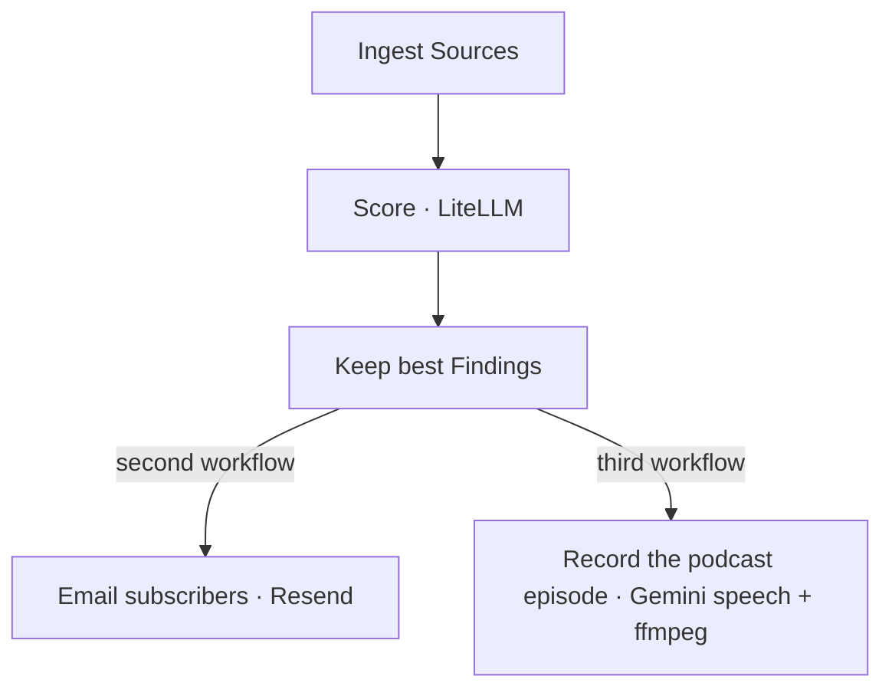
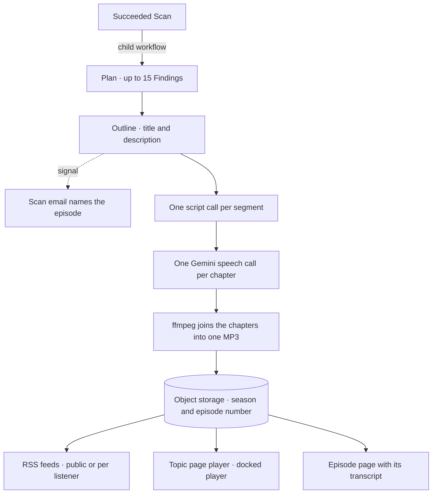
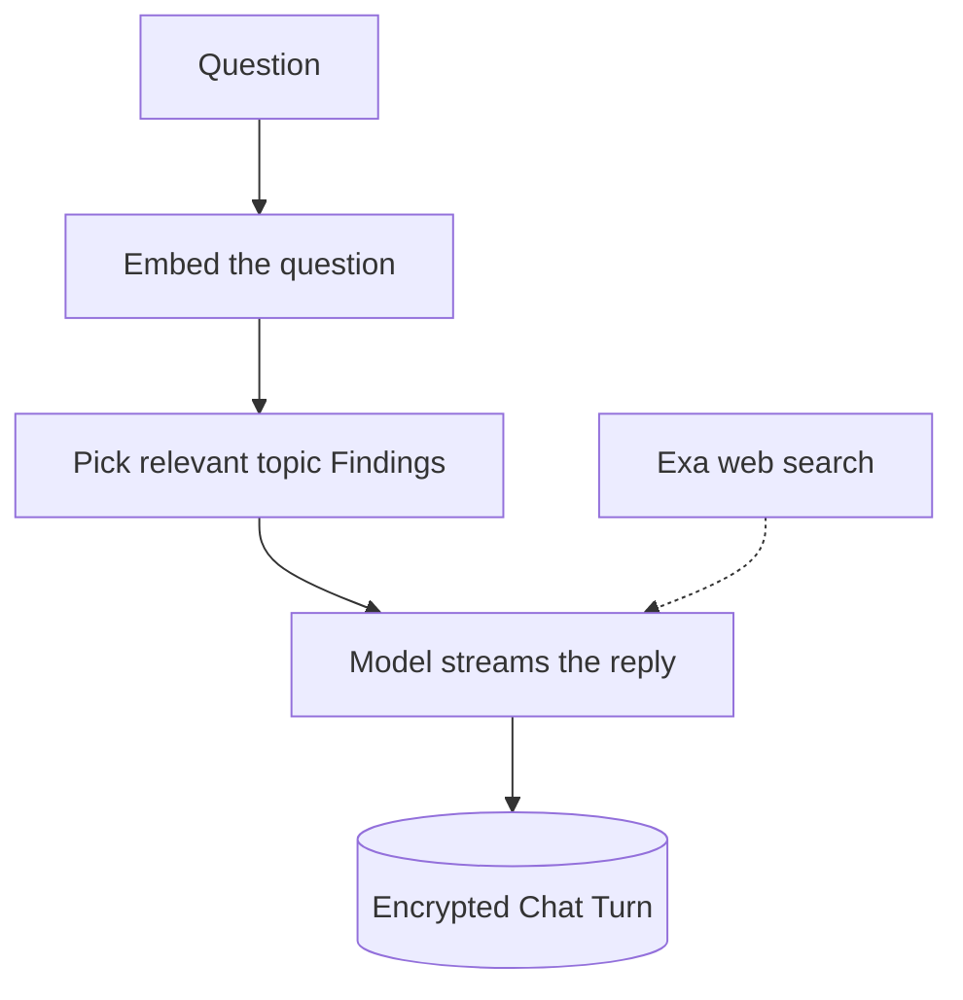
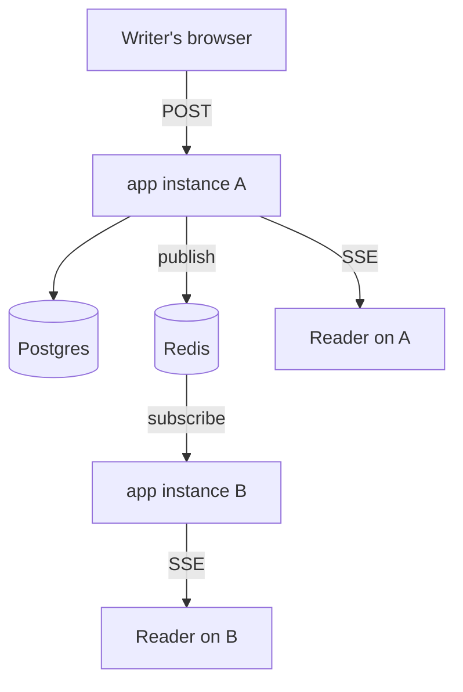

# Runtime architecture

## Scan

A topic Scan is one Temporal workflow, its email is a second one, and its podcast episode is a third:

Each step costs more but handles fewer Resources. Embeddings (`embed-model`) filter and rank what the Sources found. A
cheap model (`cheap-model`) scores what passes. A more expensive model (`score-model`) re-scores the best Findings and
writes each Finding's relevance explanation. The cheap model then writes the scan report.

Temporal persists every step and retries failed activities, so the app needs no outbox table of pending sends. Once a
Scan is complete, its workflow starts the email workflow on the `scan-emails` queue. That workflow runs one activity per
Resend call. On a rate limit the activity waits for Resend's `retry-after`, and on a 5xx it backs off. A send that fails
for good is reported to Sentry without failing the Scan. Each accepted batch records its sends with the Scan, so a retry
never mails anyone twice.

Emails outside workflows (verification, password reset, invites, flag notices) go straight to Resend. The app reports a
failed one to Sentry and does not replay it. Every call to Resend, from the app or the worker, first takes a rate limit
slot kept in Redis, which one call holds for 200 milliseconds. So calls leave evenly spaced at five a second, half of
Resend's limit of ten.

A succeeded Scan also starts the podcast episode workflow, described under Podcast below.

## Podcast

Every Topic has a podcast with two AI hosts, Carl and Vienna. A succeeded Scan starts its episode as a child workflow on
the `episode-recordings` queue, and an episode never holds up the Topic's next Scan.

The plan picks up to fifteen Findings by score. It picks from the Scan's new Findings and from the ones a user liked or
bookmarked or whose page is one of the Topic's url Sources. A like, a bookmark, and a url Source's page each add a score
bonus of 0.2. A new Finding wins a tie, and the Scan's new ones are narrated first. Any slots left go to the Topic's
best that no episode has covered, then to ones that earlier episodes covered. A Finding rated thumbs down is never
narrated.

The outline call saves the episode's title and description and signals the Scan's email workflow. The email workflow
waits for that signal, so the email can name the episode. One script call per segment writes the two hosts' turns
against the outline, in up to three drafts. A draft that fails a check is retried with the reason, and a third draft is
repaired instead of failing the episode. The sign-off ends on two fixed lines and then a goodbye that the writer words
differently every time. The prompts are in `packages/models/prompts/`.

Each chapter is recorded as one two-speaker Gemini speech call through LiteLLM's pass-through. A manual Scan's
chapters are recorded on the standard tier, and a scheduled Scan's on Gemini's Flex tier, where a chapter can wait up to
six hours for capacity. A chapter whose speech fails for good is left out, and the episode publishes the rest. ffmpeg
joins the chapters into one MP3 in object storage, and the publish gives the episode its season, the UTC year, and its
number within that season.

An episode reaches listeners three ways:

- A public Topic has a public RSS feed at `/topics/:id/podcast.xml`. A private or invite Topic gives each listener
  their own feed at `/podcast-feeds/:token.xml`. Redis caches each feed while it lists up to 100 episodes.
- The topic page has the player, and a docked player follows the listener from page to page. When an episode ends, the
  next unplayed episode from the listener's other Topics starts.
- Each published episode has its own page with its transcript, rendered on the server for a public Topic.

Every episode page has its preview card, so a shared link previews whatever the Topic's visibility. A private or invite
Topic's episode page is marked noindex and shows the Topic's gate to anyone who cannot see the Topic. Covers are drawn
over `apps/docs/design/podcast/cover-base.png`.

`PODCAST_SPEECH_MODEL` set empty turns episodes off, and `PODCAST_RECORDING_CONCURRENCY` (16 by default) limits the
episode activities on each worker replica. A free Topic gets a 10-minute episode after every scan and keeps only the
latest short one, while a paid plan gets 30 minutes and keeps every full episode. A scan that finishes while a Topic's
short episode is still recording makes no episode, and its findings go into the next one. Each plan's monthly budget
cutoffs in `packages/contracts/plans.ts` turn a paid plan's episodes short, then pause every plan's episodes, so scans
keep running.

## Chat

Every Topic has a chat. Chat runs in the `app` process, not as a workflow. A reply streams back while the user waits,
and the user asks again if a reply is lost.

Chat is retrieval-augmented generation (RAG) over the Topic's own Feed: the app retrieves the relevant Findings, and the
model writes its reply from them. If the Feed cannot answer, the model can call a live Exa web search, billed per call.
For a user who can edit the Topic, the model can also preview a change to the Topic's settings, Sources, or prompt. The
server applies that change through the Topic Tools only if the user's next message agrees.

Chat is signed-in only. Every chat turn writes a row, because every chat turn is metered. The model spend is charged to
the asker's own LiteLLM key, sharing the same budget a topic scan charges. Before a turn, a transcription, or a spoken
part runs, its largest cost is reserved in Redis. The budget is a soft limit: a call starts while the recorded spend and
the open reservations are below it, so a user with budget left is never rejected, a second call is rejected while the
first's reservation holds the rest of the budget, until the first releases its reservation, and the month passes the
budget by at most about one call's largest cost. A rejected turn is rejected before anything posts, and a reservation is
released once the turn's spend row is written. If Redis is down, the turn falls back to checking recorded spend against
the budget. Chat text is encrypted. A chat that outgrows its context budget is compacted. The newest turns stay whole.
Older answers are clipped to their opening characters.

## Live updates

One feature updates while you watch it: a team chat room. It pushes over Server-Sent Events (SSE), and no WebSocket
server runs. A Tasting Note does not stream. The editor saves the note's HTML a second after typing stops, with the
version it opened at, and the api writes only if the stored version still matches. Otherwise the api returns a conflict
naming who saved last, the words stay in the editor, and the person reloads to take the newer version.

The fan-out between instances is Redis pub/sub. The instance that stored a change delivers the change to its own
subscribers through an in-process `EventEmitter` first and then publishes the change. Every other instance re-broadcasts
what it receives to its own subscribers. The instance that published skips its own echo. The same Redis holds the
sessions, the caches for the mention count, the topic page's scan poll, and the homepage's topic section ids. It also
holds the shared rate limiters and the Resend rate limit slot, which the worker uses too. So more than one `app` replica
can run at once. Every database connection goes through Neon's connection pooler. There is no socket tier to operate.

A chat room publishes the new chat message's id and any Topic Tool calls from that chat turn, and subscribers read the
row.

Redis replays nothing published while a subscriber was disconnected. A chat stream catches up from its cursor on the
next chat message, and every open chat stream on an instance catches up once its subscriber connection comes back. A
Redis connection that drops reconnects with a backoff from one second to thirty. While Redis is unreachable, the app
reads a session from Postgres, and each cache calls its loader. Each limit counts in its own replica's memory, so a
caller gets the full limit on each replica. The storing instance still delivers to its own subscribers.

## Content safety and injection defense

Two problems sit on every page a Scan reads and every file a user shares. A page can try to instruct the model, which is
prompt injection. A page or an image can be explicit or abusive, which is content safety. The app handles them with
different tools.

**Injection defense is structural.** No scanner judges text before a model reads it. These rules hold for every call:

- The prompt writer wraps every untrusted value in an `untrusted-data` tag with a random nonce made per call, and
  strips any tag a value tries to forge, so a value cannot close its own block.
- Every template restates its task after the last untrusted block, so the model reads the app's own words last.
- Every model output the pipeline consumes is locked to a Zod schema, and numbers are clamped to their range.
- Pipeline model calls get no tools. A chat change applies only from a preview the user's next message agrees to.
- The scan report links only the urls of kept Findings, and the relevance explanation renders as plain text.

Attachment text is stored as extracted, and a url Source's page is read as fetched. Their text reaches every prompt
inside the fence, as data.

**Content safety runs in four layers**, each at the point where it costs least:

-  **Source flags.** Exa search filters out unsafe content (`moderation: true`). The Reddit ingester skips posts marked
  `over_18`. The X ingester skips tweets from accounts marked possibly sensitive. The Bluesky ingester skips posts, or
  accounts, labeled `porn`, `sexual`, `nudity`, or `graphic-media`. Reddit's RSS fallback has no flag, so the next layer
  covers it.
-  **The scorer.** The relevance score returns `isUnsafe` in the same call, at no extra cost. Content that is itself
  sexually explicit, hateful, harassing, or violent is marked unsafe on its Resource and gets no new Finding. Reporting
  on a hard subject is not unsafe. A chat link to an unsafe Resource gets no preview image.
-  **Text others read.** A room message, a note and its comments, a username, a team's name and description, and an
  invite or public Topic's name, prompt, and tags are classified by one cheap model call before they post. A violation
  is rejected in Carl's words with the draft kept.
-  **Images others see.** An uploaded avatar and an image shared to a team room go through OpenAI's free
  `omni-moderation-latest` endpoint, set by `OPENAI_API_KEY`. A flagged image gets the same rejection.

The text and image checks fail open. An unset key, a timeout, or an outage lets the post through, and a timeout or
an outage is reported without the text or the image. An image the endpoint cannot read is rejected like any unreadable
file. The report button and admin delete back up every layer.

## Caching at the edge

Cloudflare sits in front of carlnotes.com and serves what it can cache, so the `app` replicas render only what changes
from person to person.

- A page rendered for a signed-out visitor, a blog or release page, and the signed-out feed look the same to every
  visitor. Cloudflare caches each for a minute, then serves that copy for up to another minute while it fetches a fresh
  one. The browser still asks Cloudflare on every load. A request with a session cookie always goes to the app, since
  the same url shows a signed-in user something else.
- An avatar or a link-preview card names its version in its url. The browser caches it for a year and Cloudflare for a
  day, and a new image gets a new url. Hashed assets are cached for a year.
- Cloudflare compresses every text response on the way out, so the app sends them uncompressed.

Every request reaches the app from a Cloudflare address, so `TRUSTED_PROXIES` lists Cloudflare's published ranges, and
the client is the rightmost `x-forwarded-for` address outside them. Better Auth and the rate limiter read it with the
same settings. None of Cloudflare's own settings live in this repo. The cache rules, the session cookie bypass, SSL, and
the rule that lets Northflank renew its certificate are listed in the `cache-at-the-edge` change's design, under
`openspec/changes/archive/`.

## Deploy safety

A build that cannot render pages never takes the site down quietly. Each layer stops it on its own:

| Layer | What it catches | Where |
|---|---|---|
| Declared dependencies | A third-party import the workspace does not declare, or a dev dependency the image runs | `scripts/check-package-boundaries.ts` in preflight |
| Built dependencies | A package the web server build leaves external that `apps/web` does not declare | `bun run check:built-dependencies` in the Docker build |
| Image smoke | A built image that fails to migrate, boot, or render `/`, `/plans`, and both health routes | the `image-smoke` CI job, `scripts/image-smoke.sh` |
| Gated release | Any of the above, before Northflank builds, migrates, or deploys | the `release` CI job, which needs the gate and the image smoke |
| Fail fast | A production boot whose web server build is missing or cannot import, reported in the `startup` stage | `apps/api/uiServer.ts` |
| Readiness | A replica that cannot render the privacy page, which the platform sends no traffic | `/api/health/ready`, `infra/northflank/app-health-checks.json` |
| Alerts | A site that is up but not rendering, a new error in a release, and an error spike | the [deploy alerts](deployment.md#deploy-alerts) |

`/api/health` is liveness. It responds 200 while the process runs and reads nothing. `/api/health/ready` is readiness.
It renders the privacy page in-process, with no database, Redis, session, or outgoing request, so a database outage
never pulls a replica out of traffic. A render that fails is reported in the `page-render` stage with its path, and
every Sentry report is tagged with the deployed commit.
