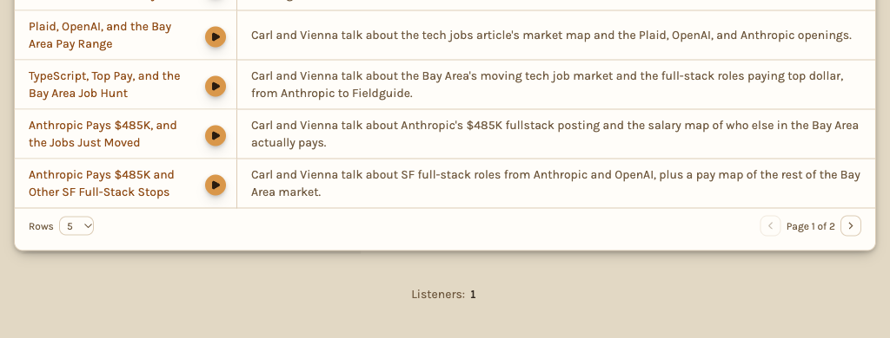

**Coffee Break** is the podcast every topic gets. After a brew, Carl and his co-host Vienna sit down and talk through
what he found. Carl reports, and Vienna asks what you would ask. No chapter ends until it reaches why the finding
matters to you. An episode runs up to 30 minutes, or up to 10 minutes on the free plan. With fewer findings, Carl and
Vienna spend longer on each one. They never pad an episode.

Carl and Vienna are AI voices. Every episode is written from the topic's findings, the brew's own first. Each chapter
says where its finding came from.

Every episode opens and closes with the show's theme song, [Coffee Break](https://www.youtube.com/watch?v=S1-nYyIzK24).
Lyrics and melody © 2022 [Laura Atkinson](http://pilgrimmusic.com/). Performed by Chase Wimberly. Production by Jimmy
Deer. Drumming by Nate Barnes.

## Where to listen

The player sits at the top of the topic page, under the title. Press play, and the page follows along. The finding on
air is highlighted, and each finding the episode covers is tagged with its chapter. Tap a tag or a chapter's title to
jump to that chapter. Tap the rest of a chapter's row to open its finding.

The home feed plays episodes too. The play button beside a topic's name plays its latest episode. Hover the button or
the episode's title to see the episode's name, date, length, and what it covers. The same button sits beside a topic's
name in every list of topics: on a profile, under your teams, on a team's page, on your activity page, and in a topic's
**Similar topics**.

**Similar topics** lists the topics most like this one by what they found and the tags they share. It lists public
topics. Once you sign in, it also lists your own topics, your teams' topics, and the invite topics you follow. The
chapter tags show on the feed's findings and inside every finding's note. A topic's **Topic roast** opens with its
latest episode, ready to play. If that episode has a film, **Coffee Break film** shows right above it, and the play
button over the film's image opens the film.

To find an episode, type in the search bar. **Podcasts** first lists the episodes whose title or description matches.
Then it lists the episodes about what you typed, even if no title says it.

- **Chapters.** One per finding. The playback bar is split by chapter, and the chapter list shows each one's source and
  times. A thumbs up or down on a chapter rates its finding, the same as rating it in the list. On a phone, tap a
  chapter to open its finding and rate it there. An episode picks its findings by score. A like, a bookmark, or a page
  that is one of the topic's url sources raises a finding's score. A finding you like or bookmark can come back in later
  episodes. A finding you rate down is never covered again. A chapter whose finding has left the list keeps its own
  rating. The finding gets that rating back if Carl finds the page again.
- **Speed and skips.** Skip back 15 seconds, skip forward 30 seconds, and change the speed. The small player at the
  bottom of the screen has both skips.
- **It keeps playing.** Go to another page, and the episode keeps playing in a small player at the bottom of the screen.
  Your phone's lock screen shows the episode and skips between chapters.
- **It remembers.** If you are signed in, an episode picks up where you stopped, on any device. When an episode ends,
  the next unplayed episode from your other topics starts.

**Coffee Break podcast episodes**, beside the brew diary, lists every episode by season, newest first. It shows 5
episodes at a time, and the page numbers under the card open the rest. A season is a calendar year, and episode numbers
start at 1 each year.

The email for a brew names its episode and links to it. If you open the link before the recording is done, the player
says so. It shows the episode once it's ready.

On the iPhone and Android apps, episodes play inside CarlNotes. The same player serves Home, topics, search, episode
pages, and chapter tags in Coffee Talk. Its small player stays across screens, with Coffee Talk above it, and sits
above the keyboard while you type. The progress bar folds away during typing; the title and playback buttons stay
within reach. Playback continues when you leave the app or lock the phone.

A chapter's title starts it from the beginning. Its numbered pill pauses or resumes the current chapter, or jumps to
another. Tap or drag the progress bar to seek; seeking a paused episode leaves it paused. Expand the chapter list to
see every chapter without restarting playback. The episode page has its full transcript, **Read more** and **Read
less**, other episodes, and similar podcasts. The headphones beside **Coffee Break podcast** and **Coffee Break
Cinema** open the theme-song credits and lyrics.

On reopening the app, your last authorized episode returns paused at its saved position and speed. Press play to
continue. A sudden shutdown can lose the seconds since the last save. Signing out stops playback and clears this
account's local resume position. If access to a private episode is revoked, playback stops when the app next checks
access. A connection problem pauses playback so you can retry.

## Watch the film

Every new episode is also a film: a wide image of its own for the opening, the closing, and the poster, an image for
each chapter's finding, and captions of what Carl and Vienna say. It is the same episode in a second format, so the film
and the audio share one place. Stop the audio at 12 minutes, press play on the film, and the film starts at 12 minutes.
When a film ends, nothing plays after it.

**Coffee Break Cinema** sits at the top of the topic page, right above the podcast player, and plays the topic's latest
film. It opens until you play the latest film, then stays closed. Open or close it yourself, and the topic page
remembers your choice until the next film. While the film plays, the finding on screen is highlighted in the list, and
a finding's chapter tag jumps the film to that chapter. Nothing plays until you press play.

The film's play button sits over the film. Press it to start, and press the film to pause. Under the film are the
skips, the speed, and the chapter-split progress bar of the audio player. Captions start on, and the captions button
turns them off. **Mute** turns off the film's sound, so you can watch with captions alone. To go back to the audio,
press play on the podcast player: the film pauses, and the audio continues from the same place. Fullscreen works
everywhere, and picture-in-picture works where your browser or phone has it. On a phone, the film keeps talking with the
screen locked.

On the web, a film in picture-in-picture keeps playing while you browse CarlNotes. Close its window on a page that shows
the film's player, and the picture returns to the player. Close it anywhere else, and the film pauses. Playing a
podcast or another film closes it.

**Coffee Break films**, just above the episodes list, lists every film by season, five at a time. Press a row's play
button to play its film in Coffee Break Cinema. An episode's own page has the same two sections in the other order, and
you can close either: **Coffee Break podcast** with the audio player, then **Coffee Break Cinema** with the film. Older
episodes made before films have no film and no Coffee Break Cinema, and an episode whose film could not be made keeps
its audio.

A film takes longer to make than its episode, from about half an hour to over an hour. Until it is ready, Coffee Break
Cinema on the episode's page says **Carl and Vienna are filming...**, and so does the topic page while the topic has no
film yet. The film takes its place when it is ready, with no reload.

Carl draws the film's image the first time the film is made, from what the episode covers. Until it is drawn, the film
opens on the episode's image. A topic's editor can change it. Pick **Edit film** in the **⋮** actions menu, right
above **Edit podcast** on the episode's page and right after **Share topic** on the topic's page, where it edits the
topic's latest film. Type an **Image prompt** and press **Regenerate** for a new image, or press the image to upload
your own JPEG, PNG, or WebP, which is cropped to the film's wide frame. Each change saves on its own, so the window
has no Save button. A regeneration counts toward the same monthly limit as your other
[images](/docs/topics/topic-and-podcast-visions/#regenerate). The poster changes at once, and the film's opening and
closing follow within about a minute. The chapters stay as they are.

Each chapter shows the image from its finding's page, and zooms in slowly while Carl and Vienna talk. A chapter of 90
seconds or longer whose finding has no image gets an imagined image. Carl draws it as the film is made, from the
finding's headline and his note on why it matters, in the film's wide style. He never draws from Personal sources or
anything else private. A film gets up to four imagined images, for its longest chapters. A shorter chapter with no
image, and a chapter past the four, shows the Carl and Vienna podcast card. An imagined image counts toward the topic
owner's plan like the episode, and a chapter whose image cannot be drawn shows the card.

Home lists films on their own, right before the podcasts: **Featured films**, which CarlNotes picks, and **New films
this week**. A film card shows the film's own image, and its play button opens the film in a window and starts it. A
**Video** button on a Brews News row opens the film in the same window. The iPhone and Android apps have Coffee Break
Cinema on the topic screen and the episode screen, Coffee Break films, the film sections on Home, and the same
buttons, which open a sheet.
In an AI chat with CarlNotes, the podcast player links to the film on carlnotes.com.

A person's Café lists their films as well. **Featured Films** sits right before Featured Podcasts. A podcast card
has its play button alone, on Home, a Café, and a team's page, so a film opens from its own card. To pick the films that
lead your own Café, open its actions menu and choose **Featured films**. Add a film, put the rows in your order, and
save. You can feature up to 12 films from your public topics. After them, the section shows the most listened film of
each other topic. Visitors see the films of your public topics only. The apps have the same section and the same menu
option.

A team's page lists the films of its topics the same way, in **Featured Films** right before Featured Podcasts. A team
has no list of its own. Films that their topics' owners featured on their Cafés lead the section, and the most
listened film of each other topic follows. Someone who is not on the team sees the films of its public topics only.

## Talk with Carl and Vienna

The small player at the bottom of the screen has a microphone beside play. The player on the topic page has one beside
the speed button. Tap either one while an episode plays, and ask out loud about what you just listened to: "what did he
mean by that?" or "Vienna, would you buy one?" The episode pauses, and Carl and Vienna listen. Your question sends
itself 1.5 seconds after you stop talking, so your hands can stay busy. The bottom player shows **Listening**, then
**Thinking**, then who is answering. A stop button takes the place of the skip buttons.

The question picks who answers. Name a host, and that host answers. Carl takes what a source said, a number, or what a
line meant, since he read everything. Vienna takes why it matters, what she thinks, or what she would do, since she sits
in your place. Anything else goes to Carl. Each host takes your question the way a radio host takes a call. Then they
answer in their own voice, about the chapter that was playing.

When the answer ends, the episode picks up where it paused. Tap stop to cut the answer short and go back to the episode.
If you pause or skip while a host is talking, the episode stays paused where you put it. Your phone's lock screen shows
who is answering, then the episode again.

The question and its answer are saved in the topic's [Coffee Talk](/docs/feed/chat/), with a small tag naming the
episode and the chapter. Tap the tag to listen to that chapter again. Talking with Carl and Vienna needs an account. It
spends from the same coffee fund as Coffee Talk. Speaking pauses once the month's spend reaches 15% of the fund on
**Free**, 40% on **Plus**, or 50% on **Premium**. You can still text with Carl.

The iPhone and Android apps have the same microphones. The first tap asks to use the microphone, and a Bluetooth
headset works for both the question and the answer. Leaving the app while Carl and Vienna listen cancels the question,
and the episode picks up again.

## Hot takes on the show

Carl and Vienna tackle hot takes in their podcast. A topic's editors share the best
[hot takes](/docs/feed/hot-takes/) with them, and the next podcast episode reads them out by each writer's username.
A hot take on a finding comes up in that finding's chapter, and any other comes up just before the sign-off. A short
podcast episode takes three and a full one five, those with the most reactions first.

## Coffee Break Discussions

Carl and Vienna also record a short talk about each [Open Mic post](/docs/feed/open-mic/), called a Coffee Break
Discussion. It plays from the post's page in this same player. It is not an episode of the podcast, so it has no
chapters, and it does not appear in a podcast app's feed.

## Subscribe in a podcast app

Press **Subscribe** on the player, then choose **Open in Apple Podcasts** on an iPhone or the podcast-app button on
Android. If no supported app is available, use **Copy feed link**, which stays available everywhere. A topic with films
also offers **Films**: choose it, and both buttons give the film feed, which lists every episode that has a film.
Paste the link into Apple Podcasts, Overcast, Pocket Casts, Castro, AntennaPod, or any app that adds a show by its link.

A public topic's feed is public. A private or invite topic's feed link is yours alone. Anyone who has the link can
listen to the topic's episodes, so keep it to yourself. The film feed uses the same link, so a reset stops both. **Reset
my link** asks for confirmation before making a new link and stopping the old one. Choose **Keep my link** to cancel. If
you unfollow the topic, your link stops working.

Each episode also has its own page with the full transcript. On a public topic, a search engine reads that page. Every
episode page ends with **Other episodes** and **Similar podcasts**. **Other episodes** lists the topic's other episodes.
**Similar podcasts** lists the episodes of other topics most like this one, each with its play button and its
description. Like Similar topics, Similar podcasts lists public topics' episodes. Once you sign in, it also lists the
episodes of the topics you can open. Click a column's heading to sort the table by it. The page's **⋮** actions menu
adds the topic to a team, shares the topic, reports an issue with it, or adds CarlNotes to your AI.

The bottom of a podcast episode page shows how many people have listened, as **Listeners**. A listener played the
podcast episode here or downloaded it in a podcast app, and counts once however often they come back.

## Turning it on and off

The topic's owner has a **Podcast** switch at the bottom of the topic's edit form. Carl can also flip it in Coffee Talk.
A new topic starts with the podcast on, and Carl can turn it off while you set the topic up together. The Artisanal
Blend card shows whether it's on. Off means no new podcast episodes. The podcast episodes already made stay.

Below it, **Hot takes for Carl and Vienna** decides whether the podcast takes the hot takes the topic's editors
share. It starts on, and only the owner can turn it off.

A topic's editor can change a podcast episode's title, description, and image. Pick **Edit podcast** in the podcast
episode page's **⋮** actions menu, change the fields, and press **Save**. The image changes save on their own, as
[Topic and podcast visions](/docs/topics/topic-and-podcast-visions/#edit-an-image) describes. A title or description
that breaks the content rules is rejected.

The owner can also remove one podcast episode. Use the trash button in the episodes list, or pick **Remove episode**
in a podcast episode page's **⋮** actions menu. Confirm **Remove podcast episode**, or choose **Keep it** to
cancel. Removal stops that podcast episode if it is playing and clears its saved position on this app. The podcast
episode leaves the topic page, every feed, and its own page for good. Its number is not used again.

## When the mugs rest

One thing changes new podcast episodes without anyone touching the switch: Carl's coffee fund running low. Brews pause
last. On **Plus**, new podcast episodes go short at 60% of the month's fund and pause at 75%. On **Premium**, they go
short at 70% and pause at 85%. On **Free**, podcast episodes are always short, and they pause at 20%. Brews keep
running. See [When the coffee fund runs low](/docs/account/plans-and-limits/#when-the-coffee-fund-runs-low).

## What each plan gets

| | Free | Plus | Premium |
| --- | --- | --- | --- |
| Episodes | Up to 10 minutes per brew, latest kept | Up to 30 minutes per brew | Up to 30 minutes per brew |

On the free plan, each brew makes an episode of up to 10 minutes. The new episode replaces the topic's last 10-minute
episode, so the topic keeps only its latest. Episodes the topic got on a paid plan stay. If a brew finishes while the
last episode is still recording, that brew makes no episode, and its findings go in the next one. The Podcast switch in
the edit form points to a paid plan, where episodes run up to 30 minutes and every full one is kept. See [Plans and
limits](/docs/account/plans-and-limits/).
