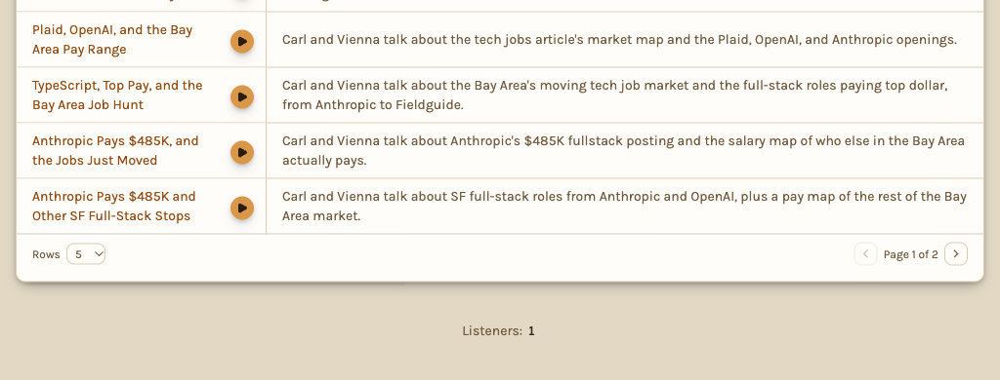

**Coffee Break** is the podcast every topic gets. After a brew, Carl and his co-host Vienna sit down and talk through
what he found. Carl reports, and Vienna asks what you would ask. No chapter ends until it reaches why the finding
matters to you. An episode runs up to 30 minutes, or up to 10 minutes on the free plan. With fewer findings, Carl and
Vienna spend longer on each one. They never pad an episode.

Carl and Vienna are AI voices. Every episode is written from the topic's findings, the brew's own first. Each chapter
says where its finding came from.

Every episode opens and closes with the show's theme song, [Coffee Break](https://www.youtube.com/watch?v=S1-nYyIzK24).
Lyrics and melody © 2022 [Laura Atkinson](http://pilgrimmusic.com/). Performed by Chase Wimberly. Production by Jimmy
Deer. Drumming by Nate Barnes.

## Where to listen

The player sits at the top of the topic page, under the title. Press play, and the page follows along. The finding on
air is highlighted, and each finding the episode covers is tagged with its chapter. Tap a tag or a chapter's title to
jump to that chapter. Tap the rest of a chapter's row to open its finding.

The home feed plays episodes too. The play button beside a topic's name plays its latest episode. Hover the button or
the episode's title to see the episode's name, date, length, and what it covers. The same button sits beside a topic's
name in every list of topics: on a profile, under your teams, on a team's page, on your activity page, and in a topic's
**Similar topics**.

**Similar topics** lists the topics most like this one by what they found and the tags they share. It lists public
topics. Once you sign in, it also lists your own topics, your teams' topics, and the invite topics you follow. The
chapter tags show on the feed's findings and inside every finding's note. A topic's **Topic roast** opens with its
latest episode, ready to play.

To find an episode, type in the search bar. **Podcasts** first lists the episodes whose title or description matches.
Then it lists the episodes about what you typed, even if no title says it.

- **Chapters.** One per finding. The playback bar is split by chapter, and the chapter list shows each one's source and
  times. A thumbs up or down on a chapter rates its finding, the same as rating it in the list. On a phone, tap a
  chapter to open its finding and rate it there. An episode picks its findings by score. A like, a bookmark, or a page
  that is one of the topic's url sources raises a finding's score. A finding you like or bookmark can come back in later
  episodes. A finding you rate down is never covered again. A chapter whose finding has left the list keeps its own
  rating. The finding gets that rating back if Carl finds the page again.
- **Speed and skips.** Skip back 15 seconds, skip forward 30 seconds, and change the speed. The small player at the
  bottom of the screen has both skips.
- **It keeps playing.** Go to another page, and the episode keeps playing in a small player at the bottom of the screen.
  Your phone's lock screen shows the episode and skips between chapters.
- **It remembers.** If you are signed in, an episode picks up where you stopped, on any device. When an episode ends,
  the next unplayed episode from your other topics starts.

**Coffee Break podcast episodes**, beside the brew diary, lists every episode by season, newest first. It shows 5
episodes at a time, and the page numbers under the card open the rest. A season is a calendar year, and episode numbers
start at 1 each year.

The email for a brew names its episode and links to it. If you open the link before the recording is done, the player
says so. It shows the episode once it's ready.

## Talk with Carl and Vienna

The small player at the bottom of the screen has a microphone beside play. The player on the topic page has one beside
the speed button. Tap either one while an episode plays, and ask out loud about what you just listened to: "what did he
mean by that?" or "Vienna, would you buy one?" The episode pauses, and Carl and Vienna listen. Your question sends
itself 1.5 seconds after you stop talking, so your hands can stay busy. The bottom player shows **Listening**, then
**Thinking**, then who is answering. A stop button takes the place of the skip buttons.

The question picks who answers. Name a host, and that host answers. Carl takes what a source said, a number, or what a
line meant, since he read everything. Vienna takes why it matters, what she thinks, or what she would do, since she sits
in your place. Anything else goes to Carl. Each host takes your question the way a radio host takes a call. Then they
answer in their own voice, about the chapter that was playing.

When the answer ends, the episode picks up where it paused. Tap stop to cut the answer short and go back to the episode.
If you pause or skip while a host is talking, the episode stays paused where you put it. Your phone's lock screen shows
who is answering, then the episode again.

The question and its answer are saved in the topic's [Coffee Talk](/docs/feed/chat/), with a small tag naming the
episode and the chapter. Tap the tag to listen to that chapter again. Talking with Carl and Vienna needs an account. It
spends from the same coffee fund as Coffee Talk. Speaking pauses once the month's spend reaches 15% of the fund on
**Free**, 40% on **Plus**, or 50% on **Premium**. You can still text with Carl.

## Subscribe in a podcast app

Press **Subscribe** on the player. On an iPhone, it opens Apple Podcasts. On Android, it opens your podcast app. **Copy
feed link** works everywhere. Paste the link into Apple Podcasts, Overcast, Pocket Casts, Castro, AntennaPod, or any app
that adds a show by its link.

A public topic's feed is public. A private or invite topic's feed link is yours alone. Anyone who has the link can
listen to the topic's episodes, so keep it to yourself. **Reset my link** makes a new link and stops the old one. If you
unfollow the topic, your link stops working.

Each episode also has its own page with the full transcript. On a public topic, a search engine reads that page. Every
episode page ends with **Other episodes** and **Similar podcasts**. **Other episodes** lists the topic's other episodes.
**Similar podcasts** lists the episodes of other topics most like this one, each with its play button and its
description. Like Similar topics, Similar podcasts lists public topics' episodes. Once you sign in, it also lists the
episodes of the topics you can open. Click a column's heading to sort the table by it. The page's **⋮** actions menu
adds the topic to a team, shares the topic, reports an issue with it, or adds CarlNotes to your AI.

The bottom of a podcast episode page shows how many people have listened, as **Listeners**. A listener played the
podcast episode here or downloaded it in a podcast app, and counts once however often they come back.

## Turning it on and off

The topic's owner has a **Podcast** switch at the bottom of the topic's edit form. Carl can also flip it in Coffee Talk.
A new topic starts with the podcast on, and Carl can turn it off while you set the topic up together. The Artisanal
Blend card shows whether it's on. Off means no new podcast episodes. The podcast episodes already made stay.

The owner can also remove one episode. Use the trash button in the episodes list, or pick **Remove episode** in an
episode page's **⋮** actions menu. The episode leaves the topic page, every feed, and its own page for
good. Its number is not used again.

## When the mugs rest

One thing changes new podcast episodes without anyone touching the switch: Carl's coffee fund running low. Brews pause
last. On **Plus**, new podcast episodes go short at 60% of the month's fund and pause at 75%. On **Premium**, they go
short at 70% and pause at 85%. On **Free**, podcast episodes are always short, and they pause at 20%. Brews keep
running. See [When the coffee fund runs low](/docs/account/plans-and-limits/#when-the-coffee-fund-runs-low).

## What each plan gets

| | Free | Plus | Premium |
| --- | --- | --- | --- |
| Episodes | Up to 10 minutes per brew, latest kept | Up to 30 minutes per brew | Up to 30 minutes per brew |

On the free plan, each brew makes an episode of up to 10 minutes. The new episode replaces the topic's last 10-minute
episode, so the topic keeps only its latest. Episodes the topic got on a paid plan stay. If a brew finishes while the
last episode is still recording, that brew makes no episode, and its findings go in the next one. The Podcast switch in
the edit form points to a paid plan, where episodes run up to 30 minutes and every full one is kept. See [Plans and
limits](/docs/account/plans-and-limits/).
