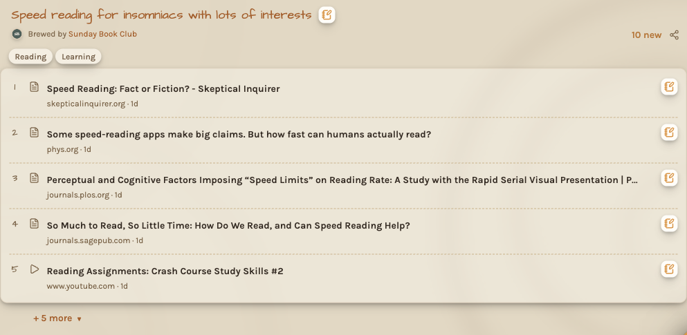
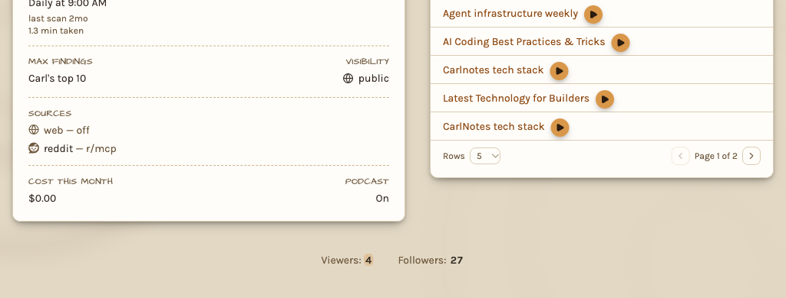

Your topic feed is every topic's findings in one place. The homepage lists your topics with their newest findings. Each
topic page holds all of the topic's findings, old and new.

## Read the finding before you open the link

The topic feed saves you time in two ways.

**The resource kind label shows the time it takes.** Every finding is marked read, watch, or listen. The label tells a
two-minute article from a forty-minute video before you open it. Filter by resource kind from the dropdown in the search
bar.

**Read Carl's note.** The headline says what the finding is. **Carl's Notes**, in the finding's popover, says why it
*matters*.

## Rate, mark read, filter

Open a finding's popover for its controls:

- **Rate this finding**: thumbs up or thumbs down, and a box to tell Carl why. What you write there goes back to him as
  feedback on the finding. A thumbs down hides the finding from your feed for good, and Carl scores pages like it lower
  from then on.
- **Mark read**: your feed tracks what you haven't read yet. The **All** view mutes what you've read, and the **Unread**
  view hides it.
- **Bookmark**: a bookmarked finding stays at the top of your feed and is never filtered out. When Carl scores what a
  brew finds, he reads up to 10 of the topic's bookmarked and thumbs-up pages, newest bookmarks first. Pages like them
  rank higher, and Coffee Break brings them back.

Sort the feed by **Relevance**, **Newest**, or **Trending**. Use the **Filters** control to filter by resource kind, by
tags, or by view. The **Reheat** button reloads the topic feed in place.

**Trending** orders findings by their views, newest first among ties. Your bookmarks stay on
top. On the homepage, Trending also orders the topics in each section by viewers, then by followers, then by their
newest finding. Featured topics keep their order.

## Viewers, followers, listeners, and views

The bottom of every topic page shows how many people have viewed the topic and how many follow it, as **Viewers** and
**Followers**. A podcast episode page shows **Listeners**: how many people have played the podcast episode here or
downloaded it in a podcast app. A number flashes when it changes, and it updates about once a minute while the page is
open.

Each count is an approximate all-time total. A person counts once, signed in or not, however often they come back.

A finding's note shows **Views**: how many times anyone has opened the finding from CarlNotes, signed in or not. Every
open counts, so one person opening a finding twice adds two.

## Email updates

Each topic you own can email you its new findings after a brew. The toggle is on your own **Profile** page, in the
**Emails** column of your topics table. Topics you follow have the same toggle in the **Topics you follow** table on
the **Activity** page.

Turning the toggle off stops the email. The topic keeps brewing, and its findings stay up to date in the feed.

The unsubscribe link inside the email stops you following another user's topic. Nothing is deleted. You can follow it
again, and turn its email back on, from the Activity page.

An invitation you haven't answered shows as a count in three places: the **Activity** row of your menu, the Activity
page's title, and the tab title. The count's tooltip names who invited you to which topic. The badge on your avatar adds
invitations to your unread chats and notes, and its tooltip lists all three.

## The Brew diary is your topic brew's history

Every topic page has a **Brew diary**: one summary per brew, with "read N · kept N" counts and that brew's recap. The
diary answers one question: did the prompt rewrite help? Rewrite the prompt, press **Brew**, and compare the new entry's
kept count and findings against the entries before it. Over a few brews, the entries show whether the rewrite helped.

## When you want to talk

The topic feed gives you one finding at a time. When the question is "what changed this month" or "where do these
sources disagree", ask [Coffee Talk](/docs/feed/chat/). Chat with Carl about what your topic's brews found. On a topic
one of your teams holds, the panel opens that team's shared chat room, where your teammates join in. For a one-to-one
conversation, pick **Private chat** in the panel's **…** menu while a topic page is open.

## Copying and sharing Carl's notes on mobile

A Finding's notes box offers **Copy Markdown for AI** and **Share Markdown**. Both include the Finding, its explanation,
and the Topic link. Share opens your device's sharing choices. Completing or cancelling it leaves the Finding open.

Inspecting a Finding does not count as opening its source. The source title, preview link, or first inline video play
records that opening. Bookmark and rating changes keep the Finding open too.
