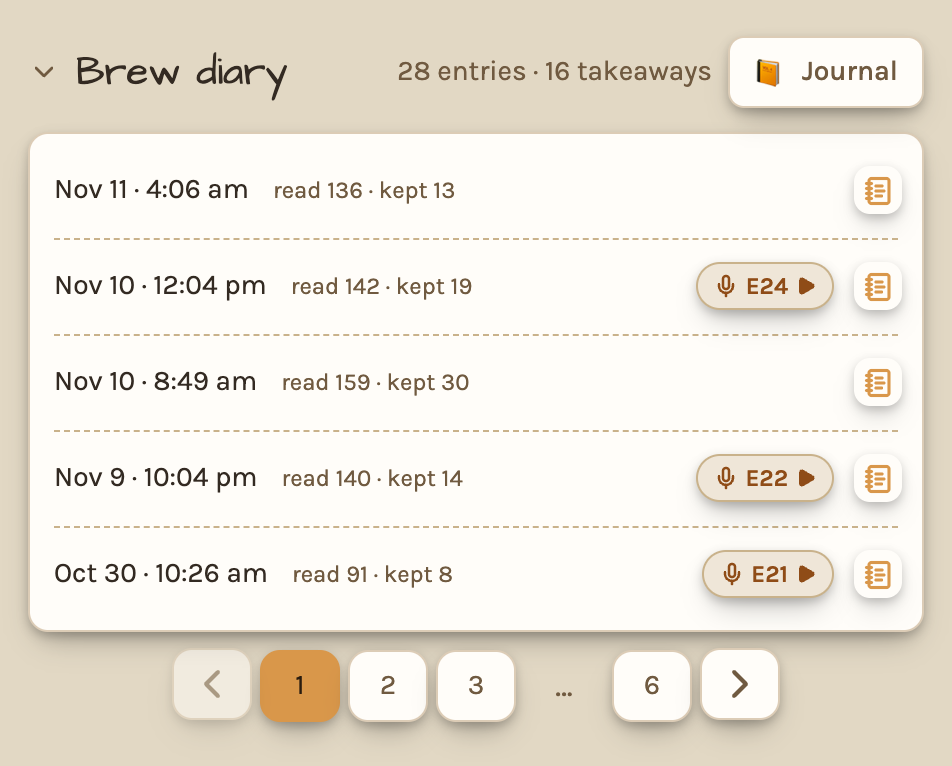
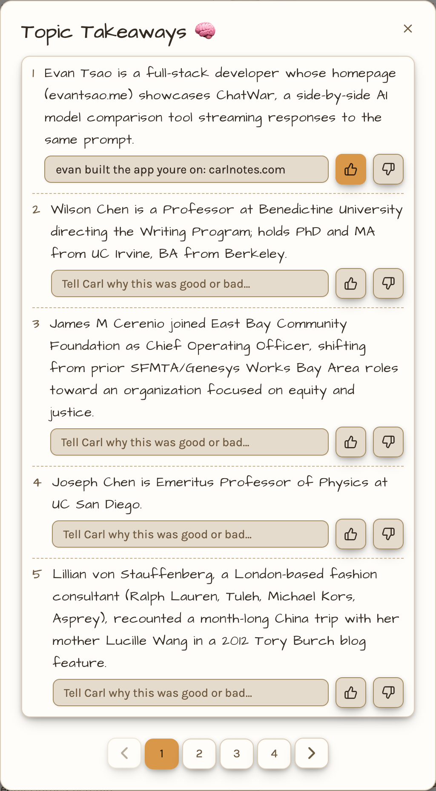

Carl gets smarter with every brew. Your Brew diary now has a 📙 Journal of the takeaways Carl has learned about your topic. He uses them in everything he writes, from finding descriptions to Coffee Break podcasts, films and discussions.

Topic owners and team leads can rate each takeaway 👍 or 👎 and add a note. A rating tells Carl what’s worth keeping. A note sets him straight. Every takeaway Carl remembers builds him into your topic’s subject matter expert.

