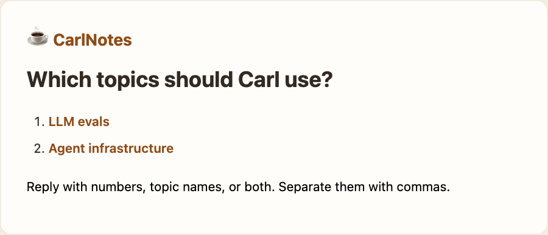
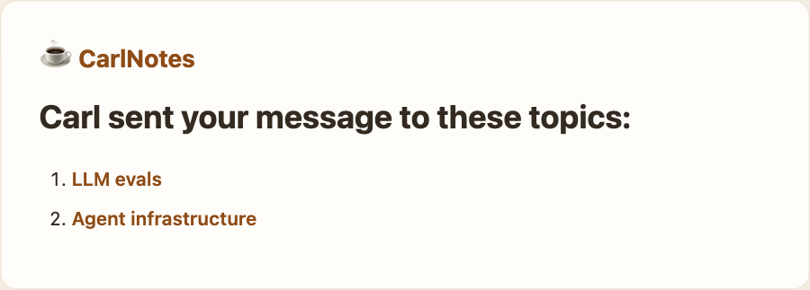

Got an email that belongs in one of your Topics? Send or forward it to **carl@updates.carlnotes.com**. Use the verified email on your Plus or Premium account.

**Try it.** Send an article and add a sentence about what you want to learn. Carl replies in the same thread with matching Topics. Nothing goes into your Topics until you choose.

Reply with a number, a Topic name, or a mix like `1, Agent infrastructure`. You can name any existing Topic you can edit. If Carl has no suggestions, just reply with a name.

Carl saves your message to the Topics you chose and replies with links to them.

## Already know where it belongs?

Put `topic: Moss terrarium` in the subject. Carl saves clear matches directly.

A `topic:` hint on the first body line helps Carl find matches, but he still waits for your choice. Only a Topic in the subject skips that step.

You can also reply to a digest with a new link and a few words. Carl skips a simple “thanks” and links quoted from the digest.

Open **Personal sources** on a topic to see your email message sources. Chats and emails are encrypted. Only you can see them.
