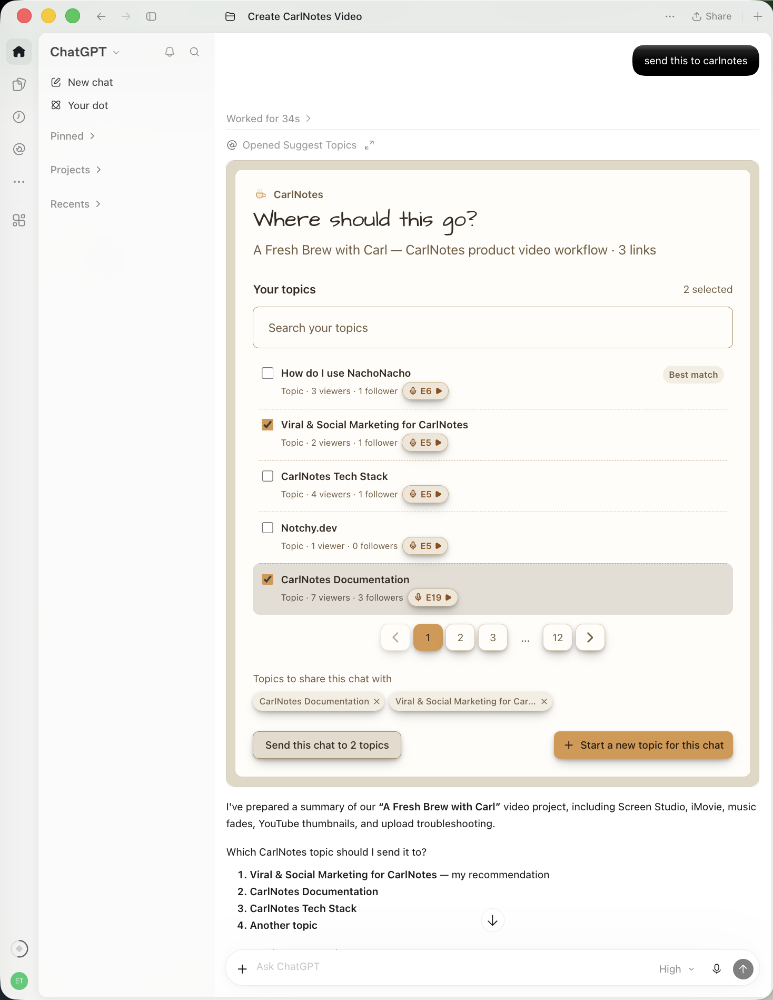

[Add the CarlNotes MCP](/docs/account/add-to-ai/#installing) and ask your connected AI **“Send this chat to Carl.”** Your AI puts together a short summary of what you worked on, what you decided, what’s still open, and the links worth keeping. You can do this on any CarlNotes plan.

## Pick your Topics

Carl shows the Topics you can edit. The closest matches start checked. Search for another Topic, or uncheck one to leave it out. Press **Send this chat** when you’re happy with your choices. One chat counts as one send, however many Topics you pick.

If this deserves its own Topic, choose **Start a new topic for this chat**. Edit the name, prompt, tags, and Sources, then press **Create this Topic**. Carl creates the Topic and saves your chat there. In an app that shows a numbered list, tell your AI which numbers you want.

Already know the destination? Try **“Send this chat to Carl for my Moss terrarium Topic.”**

## Find it again

Open **Personal sources** on the Topic to read the summary and links you sent. If your AI supplied a link back to the conversation, the source label opens it. You can delete the item here.

Chats and emails are encrypted. Only you can see them.
